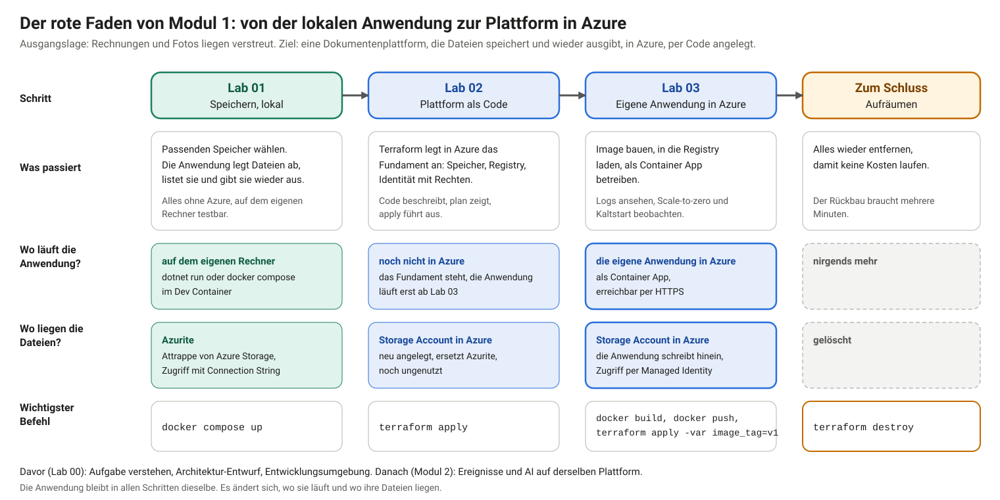
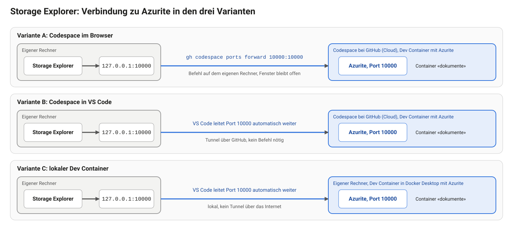

# Lab 01: Speicher wählen und Daten ablegen

## Schwerpunkte

Dieses Lab setzt Ausbaustufe 1 der Dokumentenplattform um: Dateien speichern und abrufen. Zwei Fragen stehen im Mittelpunkt. Welcher Speicher passt zu welchen Daten? Wie greift eine Anwendung auf Objektspeicher zu?

## Lernziele

- für Dateien, Metadaten und gemeinsam genutzte Laufwerke den passenden Speichertyp wählen und die Wahl begründen
- Speicherstufen (Tiers) und Redundanzoptionen nach Zugriffsmuster und Kosten einordnen
- mit einer C#-Minimal-API Dateien in einen Blob-Container schreiben, auflisten und lesen
- Eingaben prüfen: Dateityp, Dateigrösse, fehlende Datei
- die Anwendung lokal gegen Azurite betreiben, ohne Azure-Abo

## Anwendungsfall

Ausgangslage ist die Aufgabe aus Lab 00.

Ist-Zustand: Lieferantenrechnungen und Fotos liegen verteilt in Mail-Anhängen und auf Laufwerken. Es gibt keine zentrale Ablage.

Problem: Dokumente sind nicht auffindbar, und niemand weiss, welche Version die gültige ist.

Ziel: Eine Webseite nimmt Dateien entgegen, legt sie dauerhaft ab und zeigt die Liste aller Dokumente. Jede Datei lässt sich wieder herunterladen.


## Einordnung im Ablauf

Modul 1 baut in vier Schritten eine Dokumentenplattform. Lab 00 hat Aufgabe und Entwicklungsumgebung geklärt. Ab Lab 01 entsteht die Plattform. Dieses Lab ist der erste Schritt.



Die Anwendung läuft in der Entwicklungsumgebung aus Lab 00 (Dev Container), nicht in Azure. «Lokal» bedeutet in diesem Lab: ohne Azure. Je nach Variante läuft der Dev Container in einem Codespace bei GitHub (Variante A und B) oder auf dem eigenen Rechner (Variante C). Die Dateien der Anwendung liegen in Azurite, einer Attrappe von Azure Storage. Azure kommt erst in Lab 02 dazu. Dadurch lässt sich die Anwendung ohne Azure-Abo bauen und testen. In Lab 02 legt Terraform das Fundament in Azure an (Speicher, Registry, Identität), in Lab 03 läuft die Anwendung dort.

## Anforderungen

Funktional

- F1: Eine Datei lässt sich über die Webseite hochladen.
- F2: Alle abgelegten Dokumente erscheinen in einer Liste, das neueste zuerst.
- F3: Jedes Dokument lässt sich mit seinem ursprünglichen Dateinamen herunterladen.
- F4: Erlaubt sind PDF, DOCX, JPG und PNG bis 10 MB. Andere Dateien lehnt die API mit einer lesbaren Meldung ab.
- F5: Der ursprüngliche Dateiname bleibt erhalten, auch mit Umlauten und Leerzeichen.

Nicht-funktional

- N1: Dateien liegen im Objektspeicher unter nicht erratbaren Namen (GUID), nicht unter dem Dateinamen der Benutzer.
- N2: Die Anwendung läuft lokal ohne Azure, mit Azurite als Ersatz für Blob Storage.
- N3: Die Art des Zugriffs steht in der Konfiguration. Lokal dient ein Connection String, in Azure später die Managed Identity. Der Code bleibt gleich.

Nicht im Scope: Anmeldung der Benutzer, Virenprüfung, Löschen und Ändern von Dokumenten, automatische Verarbeitung (Modul 2).

## Voraussetzungen

| Voraussetzung | Prüfung |
|---|---|
| Lab 00 abgeschlossen, Entwicklungsumgebung läuft | `bash /workspaces/cas-se-labs/labs/00-setup/check.sh` im Terminal des Dev Containers meldet «Local environment is ready.» |
| Lab 01 im eigenen Repo vorhanden | Ordner `labs/01-storage` besteht, sonst **Sync fork** (Lab 00, «Spätere Labs übernehmen») |
| Docker-Daemon läuft | `docker info` im Terminal des Dev Containers zeigt unter «Server» eine Version |

Ein Azure-Abo ist für dieses Lab nicht nötig. Zum Ansehen der abgelegten Dateien dient der Azure Storage Explorer (Anhang A).

Im Codespace (Variante A und B) läuft der Docker-Daemon im Dev Container und ist sofort verfügbar. Beim lokalen Dev Container (Variante C) muss Docker Desktop bereits laufen, bevor der Dev Container geöffnet wird (Lab 00, C.5).

## Projektstand

Der Ordner `labs/01-storage` enthält zwei Stände.

- `start/` ist die Anwendung mit leeren Endpunkten. Konfiguration, Dockerfile, `docker-compose.yml` und die Webseite sind fertig.
- `solution/` ist die fertige Referenz.

Zwei Wege führen durch das Lab. Beide laufen in jeder Umgebung (Variante A, B und C aus Lab 00).

| | Übung | Demo-Modus |
|---|---|---|
| Ordner | `labs/01-storage/start` | `labs/01-storage/solution` |
| Ablauf | Die Endpunkte in `api/Program.cs` werden selbst ausgefüllt (Aufgaben 3 bis 5) | Die Demo wird mitverfolgt, der Code ist fertig, die Aufgaben 3 bis 5 werden gelesen und nicht ausgeführt |
| Aufgaben 1, 2 und 6 | wie beschrieben | wie beschrieben, im Ordner `solution` |
| Webseite nach dem Start | meldet Fehler 501, bis die Endpunkte ausgefüllt sind | funktioniert sofort |
| `solution/` | dient zum Vergleichen nach jeder Aufgabe, nicht als Vorlage zum Kopieren | ist der Arbeitsordner |

Alle Befehle laufen im Terminal des Dev Containers (**Terminal → New Terminal**, Tab `bash`) im gewählten Ordner:

```bash
cd labs/01-storage/start      # Übung
cd labs/01-storage/solution   # Demo-Modus
```

Wie die Webseite der laufenden Anwendung geöffnet wird, hängt von der Umgebung ab (Aufgabe 6, «Webseite öffnen»).

Jeder Befehl in diesem Lab nennt den Ort, an dem er ausgeführt wird. Zwei Orte kommen vor:

- **Terminal des Dev Containers:** das Terminal in VS Code oder im Browser-Codespace (Tab `bash`, Pfad `/workspaces/...` in der Eingabeaufforderung).
- **Terminal auf dem eigenen Rechner:** ein Terminal des Betriebssystems ausserhalb des Dev Containers, etwa Windows PowerShell oder das macOS-Terminal. Es wird nur für die GitHub CLI und die Prüfung von Port 10000 in Anhang A gebraucht.

Das richtige Terminal gehört zum Dev Container (Codespace oder lokaler Dev Container). Erkennbar ist es am Tab `bash` (rechts im Terminal-Bereich) und an einem Pfad, der mit `/workspaces/` beginnt. Die Eingabeaufforderung zeigt im Codespace das GitHub-Konto, den Ordner und den Branch, etwa `@konto →.../solution (main) $`. Das Wort `bash` steht nicht in der Eingabeaufforderung. Eine Eingabeaufforderung wie `PS C:\...` gehört zu einem Terminal auf dem eigenen Rechner. Dort fehlen die Werkzeuge der Umgebung. `docker compose` startet Azurite und API dann direkt auf dem eigenen Rechner und belegt dort die Ports 10000 und 8080, und die Ansicht **Ports** bleibt leer. Der Docker-Daemon gehört zum Dev Container. Im Codespace (Variante A und B) ist nichts zu starten. In Variante C muss Docker Desktop bereits laufen, bevor der Dev Container geöffnet wird (Lab 00, C.5).

In `start/api/Program.cs` markieren Kommentare mit `TODO F1`, `TODO F2` und `TODO F3` die Stellen.

## Umgebung öffnen: Variante A, B, C

Übung und Demo-Modus laufen in allen drei Varianten gleich. Die Varianten unterscheiden sich nur darin, wie die Umgebung geöffnet wird und wie die Webseite und der Storage Explorer erreicht werden. Die Einrichtung selbst steht in Lab 00.

| | Variante A: Codespace im Browser | Variante B: Codespace in VS Code | Variante C: lokaler Dev Container |
|---|---|---|---|
| Umgebung öffnen | `github.com/codespaces`, den bestehenden Codespace wählen (Lab 00, Anhang A) | VS Code, **F1 → Codespaces: Connect to Codespace** (Lab 00, Anhang B) | Docker Desktop starten, den Ordner `cas-se-labs` in VS Code öffnen, **Reopen in Container** (Lab 00, Anhang C) |
| Terminal | **Terminal → New Terminal**, Tab `bash`, Pfad `/workspaces/...` | wie A | wie A |
| Ordner | `cd labs/01-storage/start` (Übung) oder `cd labs/01-storage/solution` (Demo-Modus) | wie A | wie A |
| Docker | läuft im Codespace, nichts zu starten | wie A | läuft im Dev Container, Docker Desktop muss vor dem Öffnen laufen |
| Webseite öffnen | Ansicht **Ports**, Zeile «API + SPA», Adresse `https://<Codespace-Name>-8080.app.github.dev` (Aufgabe 6) | `http://localhost:8080` im eigenen Browser | `http://localhost:8080` im eigenen Browser |
| Storage Explorer (Anhang A) | Port 10000 braucht `gh codespace ports forward 10000:10000` auf dem eigenen Rechner (A.2) | VS Code leitet Port 10000 automatisch auf den eigenen Rechner (A.2) | wie B |
| Danach | Codespace stoppen (Lab 00, «Aufräumen») | Codespace stoppen | Dev Container schliessen: **F1 → Dev Containers: Reopen Folder Locally** |

## Aufgabe 1: Speicher wählen

Objekt-, Datei-, relationaler Speicher und Dokumentdatenbank lösen verschiedene Probleme. Die Wahl richtet sich nach dem Zugriffsmuster: Wie gross sind die Daten, wie wird gelesen, wie lange müssen sie aufbewahrt werden?

Vier Speichertypen als Ausgangspunkt:

| Typ | Azure-Dienst | Geeignet für |
|---|---|---|
| Objektspeicher | Blob Storage | grosse, unveränderliche Dateien, Zugriff über HTTP |
| Dateispeicher | Azure Files | Laufwerk mit SMB oder NFS für Anwendungen, die ein Dateisystem erwarten |
| relational | Azure SQL | strukturierte Daten mit Beziehungen und Abfragen über mehrere Felder |
| Dokumentdatenbank | Cosmos DB | flexible JSON-Dokumente, grosse Mengen, Abfrage nach Schlüssel |

**Ablauf**

Für jeden der drei Fälle den Speichertyp wählen und in zwei Sätzen begründen.

1. Fall A: Rechnungs-PDFs und Fotos, zehn Jahre aufzubewahren, nach dem ersten Monat nur noch selten gelesen.
2. Fall B: Metadaten zu jedem Dokument (Lieferant, Betrag, Status), Abfrage nach Lieferant und Status.
3. Fall C: Eine bestehende Desktop-Anwendung erwartet ein Netzlaufwerk mit Ordnern.

Danach zu Fall A Stufe und Redundanz festlegen:

1. Stufe: Hot, Cool, Cold oder Archive. Je kälter die Stufe, desto günstiger der Speicherplatz und desto teurer die Zugriffe. Mindestaufbewahrung: Cool 30 Tage, Cold 90 Tage, Archive 180 Tage. Eine frühere Löschung oder ein früherer Wechsel kostet eine Gebühr.
2. Redundanz: LRS (drei Kopien in einem Rechenzentrum), ZRS (drei Verfügbarkeitszonen einer Region) oder GRS (zusätzlich asynchron in eine zweite Region). Je weiter die Kopien verteilt sind, desto höher der Preis und desto besser der Schutz vor Ausfällen. Redundanz schützt nicht vor versehentlichem Löschen oder Überschreiben, weil alle Kopien dieselbe Änderung erhalten.

**Erwartetes Ergebnis**

- Fall A: Blob Storage. Nach 30 Tagen Cool oder Cold, bei sehr seltenem Zugriff später Archive. Redundanz nach dem Schutzbedarf: LRS genügt für Kopien, die sich neu erzeugen lassen, ZRS oder GRS für Originale. Archive setzt LRS oder GRS voraus und ist mit ZRS nicht kombinierbar.
- Fall B: Dokumentdatenbank oder relationale Datenbank. Blob-Metadaten sind nicht indexiert und lassen sich nicht abfragen. Blob-Index-Tags sind durchsuchbar, aber auf zehn Tags pro Blob begrenzt und für Abfragen nach mehreren Feldern zu knapp. Ausbaustufe 2 nutzt dafür Cosmos DB.
- Fall C: Azure Files, weil nur ein Laufwerk ein Dateisystem bereitstellt.

**Was schiefgehen kann**

- Blob Storage als Datenbank verwenden: Die Suche nach Inhalten eines Dokuments gelingt nicht, nur das Listen nach Namen. Dafür braucht es einen Index oder eine Datenbank.
- Egress-Kosten übersehen: Daten, die eine Azure-Region verlassen, werden pro GB verrechnet. Zwischen Azure-Diensten derselben Region fallen in der Regel keine Transfergebühren an, Ausnahmen nennt die Bandbreiten-Preisseite.
- Archive-Stufe für Daten wählen, die doch gebraucht werden: Archivierte Blobs sind nicht lesbar, bis sie in eine Online-Stufe zurückgeholt sind. Die Rückholung dauert bei Standard-Priorität bis zu 15 Stunden und kostet extra.
- Partition Key in Cosmos DB zu spät wählen: Der Schlüssel lässt sich nicht an Ort und Stelle ändern. Eine Änderung braucht einen neuen Container und eine Datenkopie.

Verfügbarkeit und Preise von Stufen und Redundanz hängen von der Region ab. Vor einer Entscheidung die aktuelle Preisseite von Azure prüfen.

**Weiterführend**

- [Übersicht Azure Storage](https://learn.microsoft.com/azure/storage/common/storage-introduction): Dienste und Speichertypen im Überblick
- [Einführung in Blob Storage](https://learn.microsoft.com/azure/storage/blobs/storage-blobs-introduction): Storage Account, Container, Blobs
- [Azure Files](https://learn.microsoft.com/azure/storage/files/storage-files-introduction): Dateifreigaben mit SMB und NFS
- [Datenspeicher in Azure im Überblick](https://learn.microsoft.com/azure/architecture/guide/technology-choices/data-store-overview): Entscheidungshilfe für den Speichertyp
- [Azure Cosmos DB](https://learn.microsoft.com/azure/cosmos-db/introduction) und [Partitionierung](https://learn.microsoft.com/azure/cosmos-db/partitioning-overview): Dokumentdatenbank und Wahl des Partition Keys
- [Zugriffsstufen für Blobs](https://learn.microsoft.com/azure/storage/blobs/access-tiers-overview): Hot, Cool, Cold, Archive und Mindestaufbewahrung
- [Rückholung aus der Archive-Stufe](https://learn.microsoft.com/azure/storage/blobs/archive-rehydrate-overview): Dauer und Priorität
- [Redundanz in Azure Storage](https://learn.microsoft.com/azure/storage/common/storage-redundancy): LRS, ZRS, GRS im Vergleich
- [Blob-Index-Tags](https://learn.microsoft.com/azure/storage/blobs/storage-blob-index-how-to): durchsuchbare Tags und ihre Grenzen
- [Preise Blob Storage](https://azure.microsoft.com/pricing/details/storage/blobs/) und [Preise Datenübertragung](https://azure.microsoft.com/pricing/details/bandwidth/): Speicherplatz, Zugriffe, Egress

## Aufgabe 2: Azurite starten

Azurite ist ein Emulator für Blob Storage, der lokal auf Port 10000 läuft. Er verwendet ein fest definiertes Entwicklungskonto mit öffentlich bekanntem Schlüssel. Das ist kein Geheimnis und gilt nur für lokale Tests.

Azurite läuft als Container. Der Container braucht einen laufenden Docker-Daemon. Er gehört in allen drei Varianten zum Dev Container.

**Ablauf**

1. Prüfen, ob der Docker-Daemon läuft (Terminal des Dev Containers):

   ```bash
   docker info
   ```

   Die Ausgabe enthält einen Abschnitt «Server» mit einer Versionsnummer. Dann läuft Docker.

2. Azurite starten und den Status prüfen, im Terminal des Dev Containers und im gewählten Ordner (`labs/01-storage/start`, im Demo-Modus `labs/01-storage/solution`):

   ```bash
   docker compose up -d azurite
   docker compose ps
   ```

**Erwartetes Ergebnis**

`docker compose ps` zeigt den Dienst `azurite` mit dem Status `Up` und dem Port `10000`.

**Was schiefgehen kann**

- `Cannot connect to the Docker daemon` oder kein Abschnitt «Server» bei `docker info`: Die Umgebung wurde ohne Docker-Daemon gestartet. Im Codespace **F1 → Codespaces: Rebuild Container**, im lokalen Dev Container **F1 → Dev Containers: Rebuild Container**. Beim lokalen Dev Container muss Docker Desktop laufen (Lab 00, C.5).
- `failed to connect to the docker API ... npipe` in einem PowerShell-Fenster: Das Fenster gehört zum eigenen Rechner und nicht zum Dev Container. Der Befehl gehört in das Terminal des Dev Containers.
- Port 10000 ist belegt: Ein anderer Azurite oder Prozess läuft bereits. Mit `docker compose down` aufräumen oder den anderen Prozess beenden.

**Weiterführend**

- [Azurite für lokale Azure-Storage-Entwicklung](https://learn.microsoft.com/azure/storage/common/storage-use-azurite): Optionen, Ports, Entwicklungskonto
- [Docker Compose](https://docs.docker.com/compose/) und [`docker compose up`](https://docs.docker.com/reference/cli/docker/compose/up/): Konzept und Befehl

## Aufgabe 3: Hochladen (F1, F4, F5)

Blob Storage speichert Dateien als Blobs in einem Container. Der Blob-Name ist ein beliebiger String. Metadaten sind Schlüssel-Wert-Paare. Sie werden als HTTP-Header übertragen und müssen deshalb als solche gültig sein. Sicher gültig ist nur ASCII-Text, Sonderzeichen wie Umlaute können scheitern. Der ursprüngliche Dateiname wird deshalb URL-kodiert abgelegt. Namen von Metadaten folgen den Regeln für C#-Bezeichner, die Gesamtgrösse ist auf 8 KB begrenzt.

**Ablauf**

In `start/api/Program.cs` den Endpunkt `POST /api/documents` ausfüllen.

1. Das Formular lesen und die erste Datei nehmen. Fehlt sie oder ist sie leer, 400 mit `{ error }` antworten. Ein zu grosses Formular löst eine Ausnahme aus, die ebenfalls als 400 mit lesbarer Meldung zurückgeht:

   ```csharp
   IFormFile? file;
   try
   {
       if (!request.HasFormContentType)
           return Results.BadRequest(new { error = "Keine Datei übermittelt." });
       file = (await request.ReadFormAsync(ct)).Files.FirstOrDefault();
   }
   catch (Exception e) when (e is InvalidDataException or BadHttpRequestException)
   {
       return Results.BadRequest(new { error = "Datei ist grösser als 10 MB." });
   }

   if (file is null || file.Length == 0)
       return Results.BadRequest(new { error = "Keine Datei übermittelt." });
   if (file.Length > MaxFileSize)
       return Results.BadRequest(new { error = "Datei ist grösser als 10 MB." });
   ```

2. Die Dateiendung gegen `allowedTypes` prüfen. Bei einer anderen Endung 400 mit der Liste der erlaubten Typen:

   ```csharp
   var extension = Path.GetExtension(file.FileName);
   if (!allowedTypes.TryGetValue(extension, out var contentType))
       return Results.BadRequest(new { error = "Erlaubt sind PDF, DOCX, JPG und PNG." });
   ```

3. Eine GUID als Blob-Name erzeugen und die Datei hochladen. Der Content-Type kommt aus `allowedTypes`, nicht vom Client:

   ```csharp
   var id = Guid.NewGuid().ToString();
   var blob = container.GetBlobClient(id);
   await using var stream = file.OpenReadStream();
   await blob.UploadAsync(stream, new BlobUploadOptions
   {
       HttpHeaders = new BlobHttpHeaders { ContentType = contentType },
       Metadata = new Dictionary<string, string>
       {
           [MetaFileName] = Uri.EscapeDataString(Path.GetFileName(file.FileName)),
       },
   }, ct);
   ```

4. Mit 201 und der neuen Id antworten. Dabei die Zeilen `await Task.CompletedTask;` und `return Results.StatusCode(...)` entfernen:

   ```csharp
   return Results.Created($"/api/documents/{id}/content", new { id, fileName = file.FileName, status = "hochgeladen" });
   ```

**Erwartetes Ergebnis**

`dotnet build api` (Terminal des Dev Containers, im Ordner `start`) läuft ohne Fehler. Der Upload liefert Status 201 und eine Id.

**Was schiefgehen kann**

- Der Compiler meldet fehlende Typen wie `BlobUploadOptions`: Die `using`-Zeilen am Dateianfang fehlen oder wurden gelöscht.
- Metadaten mit Umlauten lösen eine Ausnahme aus: Der Wert wurde nicht mit `Uri.EscapeDataString` kodiert.
- Der Dateiname im Blob-Namen verursacht Sonderzeichenfehler oder Kollisionen: Deshalb die GUID als Name und der Dateiname nur als Metadatum.

**Weiterführend**

- [Blob in .NET hochladen](https://learn.microsoft.com/azure/storage/blobs/storage-blob-upload): `UploadAsync`, Optionen, Content-Type
- [Eigenschaften und Metadaten von Blobs in .NET](https://learn.microsoft.com/azure/storage/blobs/storage-blob-properties-metadata): setzen und lesen
- [Namen für Container, Blobs und Metadaten](https://learn.microsoft.com/rest/api/storageservices/naming-and-referencing-containers--blobs--and-metadata): Regeln und Grenzen
- [Minimal APIs in ASP.NET Core](https://learn.microsoft.com/aspnet/core/fundamentals/minimal-apis): Aufbau von `Program.cs`
- [Dateien in ASP.NET Core hochladen](https://learn.microsoft.com/aspnet/core/mvc/models/file-uploads): `IFormFile`, Grössenlimits, Sicherheitshinweise
- [Antiforgery in ASP.NET Core](https://learn.microsoft.com/aspnet/core/security/anti-request-forgery): Hintergrund zu `DisableAntiforgery()`

## Aufgabe 4: Auflisten (F2)

Beim Auflisten liefert Blob Storage Metadaten nur auf Anfrage mit. `BlobTraits.Metadata` fordert sie an.

**Ablauf**

Den Endpunkt `GET /api/documents` ausfüllen. Dabei die Zeilen `await Task.CompletedTask;` und `return Results.StatusCode(...)` dieses Endpunkts entfernen:

```csharp
var items = new List<DocumentInfo>();
await foreach (var item in container.GetBlobsAsync(BlobTraits.Metadata, cancellationToken: ct))
{
    item.Metadata.TryGetValue(MetaFileName, out var encoded);
    items.Add(new DocumentInfo(
        item.Name,
        encoded is null ? item.Name : Uri.UnescapeDataString(encoded),
        item.Properties.ContentType,
        item.Properties.ContentLength ?? 0,
        item.Properties.CreatedOn,
        "hochgeladen"));
}
return Results.Ok(items.OrderByDescending(i => i.UploadedAt));
```

**Erwartetes Ergebnis**

`GET /api/documents` liefert ein JSON-Array. Es ist leer, solange nichts hochgeladen wurde, danach enthält es die Einträge, das neueste zuerst.

**Was schiefgehen kann**

- Der Dateiname fehlt in der Liste: `BlobTraits.Metadata` wurde nicht übergeben.
- Die Liste ist nicht sortiert: `OrderByDescending` fehlt. Blob Storage garantiert keine Reihenfolge nach Datum.

**Weiterführend**

- [Blobs in .NET auflisten](https://learn.microsoft.com/azure/storage/blobs/storage-blobs-list): Paging, Traits wie `BlobTraits.Metadata`

## Aufgabe 5: Herunterladen (F3, F5)

Ein Blob lässt sich als Stream lesen. Die API gibt den Stream an den Browser weiter, ohne die Datei vollständig in den Speicher zu laden.

**Ablauf**

Den Endpunkt `GET /api/documents/{id}/content` ausfüllen. Dabei die Zeilen `await Task.CompletedTask;` und `return Results.StatusCode(...)` dieses Endpunkts entfernen:

```csharp
var blob = container.GetBlobClient(id.ToString());
if (!await blob.ExistsAsync(ct))
    return Results.NotFound();

var props = (await blob.GetPropertiesAsync(cancellationToken: ct)).Value;
props.Metadata.TryGetValue(MetaFileName, out var encoded);
var fileName = encoded is null ? id.ToString() : Uri.UnescapeDataString(encoded);

var stream = await blob.OpenReadAsync(cancellationToken: ct);
return Results.File(stream, props.ContentType, fileName);
```

**Erwartetes Ergebnis**

Der Download liefert die Datei mit dem ursprünglichen Namen und dem richtigen Content-Type. Eine unbekannte Id ergibt 404.

**Was schiefgehen kann**

- Die Route ohne die Einschränkung `:guid` lässt beliebige Zeichenfolgen als Blob-Name zu, darunter Pfadangaben.
- Der heruntergeladene Dateiname zeigt die GUID statt des Originalnamens: Das Metadatum wurde nicht gelesen oder nicht dekodiert.

**Weiterführend**

- [Blob in .NET herunterladen](https://learn.microsoft.com/azure/storage/blobs/storage-blob-download): Stream, Datei, Speicher
- [Routing in ASP.NET Core](https://learn.microsoft.com/aspnet/core/fundamentals/routing): Routen und Einschränkungen wie `{id:guid}`
- [Antworten in Minimal APIs](https://learn.microsoft.com/aspnet/core/fundamentals/minimal-apis/responses): `Results.File`, `Results.Created`, `Results.BadRequest`

## Aufgabe 6: Anwendung starten und prüfen

**Ablauf**

Die Anwendung ist die C#-API. Sie liefert zugleich die Webseite (die SPA, eine einzelne `index.html`) aus. Zwei Starts stehen zur Wahl. Start 1 ist der Standard, Start 2 dient zum Debuggen.

Beide Befehle werden im Terminal des Dev Containers eingegeben (Tab `bash`, Pfad `/workspaces/...` in der Eingabeaufforderung), im Ordner des Labs (`labs/01-storage/start` oder `labs/01-storage/solution`). Zeigt die Eingabeaufforderung `PS /workspaces/...`, ist eine PowerShell geöffnet und die Befehle unten schlagen fehl. Im Terminal-Bereich neben dem `+` den Pfeil öffnen und **bash** wählen. Der Befehl `pwd` zeigt den aktuellen Ordner, `cd labs/01-storage/solution` wechselt dorthin, ausgehend vom Hauptordner `/workspaces/cas-se-labs`.

**Start 1: alles als Container (Standard)**

Der Befehl baut aus dem Code ein Container-Image, startet die API als Container und startet Azurite mit, falls es noch nicht läuft. Der Azurite-Container aus Aufgabe 2 wird weiterverwendet. Das Terminal bleibt belegt und zeigt die Log-Ausgabe der Anwendung. Für weitere Befehle ein zweites Terminal öffnen (**Terminal → New Terminal**).

```bash
docker compose up --build
```

**Start 2: API direkt starten, ohne Container-Image (zum Debuggen)**

Der Befehl startet die API ohne Container-Image direkt mit `dotnet`. Azurite läuft dabei weiter als Container aus Aufgabe 2. Der Start eignet sich zum Debuggen, weil kein Image gebaut wird. Beendet wird die API mit `Ctrl+C` im selben Terminal. Die zwei Variablen vor `dotnet` legen fest, dass die API auf Port 8080 lauscht und im Modus «Development» läuft. Die Verbindung zu Azurite steht in `api/appsettings.Development.json`.

```bash
ASPNETCORE_URLS=http://localhost:8080 ASPNETCORE_ENVIRONMENT=Development dotnet run --project api
```

Die API nimmt Anfragen auf Port 8080 entgegen (technisch: sie lauscht auf diesem Port). Die Webseite und die API liegen unter derselben Adresse. Die Adresse hängt von der Umgebung ab:

| Umgebung | Adresse der Webseite |
|---|---|
| Variante A: Codespace im Browser | Die Anwendung läuft in der Cloud, `localhost:8080` im Browser des eigenen Rechners erreicht sie nicht. In VS Code die Ansicht **Ports** öffnen (neben dem Terminal). Die Zeile «API + SPA» (Port 8080) erscheint, sobald die Anwendung läuft. Die Adresse in der Spalte «Forwarded Address» hat die Form `https://<Name des Codespace>-8080.app.github.dev`. Die Benachrichtigung «Open in Browser» öffnet sie im Browser, alternativ lässt sich die Adresse kopieren und im Browser einfügen. Der Port ist privat, die Adresse öffnet nur im Browser, der bei GitHub angemeldet ist. |
| Variante B: Codespace in VS Code | Die Ansicht **Ports** leitet Port 8080 auf den eigenen Rechner. `http://localhost:8080` im eigenen Browser öffnet die Webseite. |
| Variante C: lokaler Dev Container | `http://localhost:8080` im eigenen Browser. |

Nach dem Öffnen der Webseite prüfen:

1. Eine PDF-Datei hochladen. Sie erscheint in der Liste.
2. Die Datei über den Link in der Liste herunterladen und mit dem Original vergleichen.
3. Eine PDF-Datei mit Umlaut und Leerzeichen im Namen hochladen, zum Beispiel `Rechnung Müller.pdf`. Name in der Liste und Name beim Download müssen dem Original entsprechen (F5).
4. Eine Textdatei per Drag & Drop auf die Upload-Fläche ziehen. Der Dateidialog zeigt nur die erlaubten Typen, ausser der Filter steht auf «Alle Dateien». Die Webseite zeigt «<Dateiname>: Erlaubt sind PDF, DOCX, JPG und PNG.»
5. Den Inhalt des Containers im Azure Storage Explorer auf dem eigenen Rechner ansehen (Installation und Bedienung in Anhang A dieses Labs, für die Definition of Done nicht nötig): Container `dokumente`, Blob-Name als GUID, Metadatum `originalname`.
6. Die API zusätzlich ohne Webseite ansprechen. `curl` ist ein Programm, das HTTP-Anfragen von der Kommandozeile sendet. Die Anfragen gehen an die API im Dev Container und verwenden deshalb in allen Varianten `http://localhost:8080`, auch im Codespace im Browser.

   Ort: ein zweites Terminal des Dev Containers (Tab `bash`, **Terminal → New Terminal**), weil das erste die laufende Anwendung zeigt. Zuerst in den Ordner des Labs wechseln. Dort liegt die Beispieldatei `sample.pdf`. Ohne diesen Wechsel meldet `curl` «Failed to open/read local data from file/application»:

   ```bash
   cd /workspaces/cas-se-labs/labs/01-storage/start      # Übung
   cd /workspaces/cas-se-labs/labs/01-storage/solution   # Demo-Modus
   ```

   Der erste Befehl lädt `sample.pdf` hoch, der zweite ruft die Liste ab, der dritte fragt eine Id ab, die nicht existiert. Die Option `-i` zeigt zusätzlich den Status und die Header der Antwort:

   ```bash
   curl -i -F "file=@sample.pdf" http://localhost:8080/api/documents
   curl -i http://localhost:8080/api/documents
   curl -i http://localhost:8080/api/documents/00000000-0000-0000-0000-000000000000/content
   ```

   Erwartet werden die Status 201, 200 und 404 (Tabelle unten).

   Alternative zu `curl`: die Datei `test.http`. Sie enthält dieselben Anfragen als Text, und «REST Client» sendet sie per Klick. REST Client ist eine Erweiterung von VS Code, die HTTP-Anfragen aus einer Textdatei sendet und die Antwort daneben anzeigt. Sie ist im Dev Container bereits installiert (Ansicht **Extensions**, Name «REST Client»). Die Aufgabe lässt sich auch ohne `test.http` abschliessen.

   Aufbau der Datei: Zeilen mit `###` trennen die Anfragen und dienen als Überschrift. Die erste Zeile `@host = http://localhost:8080` legt die Adresse der API fest, `{{host}}` in den Anfragen steht für diesen Wert. Pro Anfrage steht die Methode (`GET` oder `POST`) und die Adresse, beim Upload zusätzlich die Datei (`< ./sample.pdf`).

   Ablauf:

   1. Im Explorer von VS Code `test.http` im Ordner des Labs doppelklicken (`labs/01-storage/start` in der Übung, `labs/01-storage/solution` im Demo-Modus). Die Datei öffnet sich im Editor.
   2. Über jeder Anfrage erscheint der graue Link **Send Request**, zum Beispiel über `GET {{host}}/healthz` (unter «### Health»). Auf **Send Request** klicken.
   3. Rechts neben der Datei öffnet sich ein neuer Tab «Response». Er zeigt Status, Header und Inhalt der Antwort, etwa `HTTP/1.1 200 OK` und den Inhalt `"ok"`.
   4. Die Anfragen der Reihe nach senden: «Health», «Upload a PDF», «List documents». Beim Upload ist Status 201 mit einer `id` erwartet. Die `id` aus der Liste in die Zeile unter «### Download» an Stelle von `00000000-0000-0000-0000-000000000000` einsetzen und **Send Request** wählen. Die Antwort enthält den Dateiinhalt, im Header `Content-Disposition` steht der Originalname.

   Erscheint der Link **Send Request** nicht, ist die Erweiterung nicht aktiv oder die Datei hat nicht die Endung `.http`. Dann `curl` verwenden.

**Erwartetes Ergebnis**

| Aktion | Antwort |
|---|---|
| Upload PDF | 201, JSON mit `id` |
| Upload `.txt` | 400, «Erlaubt sind PDF, DOCX, JPG und PNG.» |
| Upload über 10 MB | 400, «Datei ist grösser als 10 MB.» |
| Upload ohne Datei | 400, «Keine Datei übermittelt.» |
| Liste | 200, JSON-Array |
| Download mit unbekannter Id | 404 |

**Was schiefgehen kann**

- Die Webseite zeigt «Liste konnte nicht geladen werden (501)»: Ein Endpunkt ist noch nicht ausgefüllt. Im Demo-Modus tritt das nicht auf. Dann läuft vermutlich `start/` statt `solution/`.
- Im Codespace (Variante A) fehlt die Zeile «API + SPA» in der Ansicht **Ports**: Die Anwendung läuft noch nicht oder hat einen Fehler gemeldet. Das Terminal mit `docker compose up --build` zeigt die Ursache. Sobald der Port lauscht, erscheint die Zeile.
- `Connection refused` auf Port 10000: Azurite läuft nicht (Aufgabe 2).
- Der Port 8080 ist belegt: Ein früherer Lauf läuft noch. `docker compose down` beendet ihn.
- Nach `docker compose down` sind die Daten weg: Azurite legt sie im Container ab, und `down` entfernt den Container. Für dieses Lab ist das gewollt. `docker compose stop` und `start` behalten die Daten.

**Weiterführend**

- [Konfiguration in ASP.NET Core](https://learn.microsoft.com/aspnet/core/fundamentals/configuration/): Quellen, Umgebungsvariablen mit `__` (Anforderung N3)
- [Dependency Injection in ASP.NET Core](https://learn.microsoft.com/aspnet/core/fundamentals/dependency-injection): Registrierung des `BlobContainerClient`
- [Statische Dateien in ASP.NET Core](https://learn.microsoft.com/aspnet/core/fundamentals/static-files): Auslieferung der SPA aus `wwwroot`
- [Authentifizierung mit dem Azure SDK für .NET](https://learn.microsoft.com/dotnet/azure/sdk/authentication/) und [Credential Chains](https://learn.microsoft.com/dotnet/azure/sdk/authentication/credential-chains): `DefaultAzureCredential`
- [Managed Identities](https://learn.microsoft.com/entra/identity/managed-identities-azure-resources/overview): Zugriff ohne Schlüssel in Azure (ab Lab 02)
- [Port-Weiterleitung in Codespaces](https://docs.github.com/codespaces/developing-in-a-codespace/forwarding-ports-in-your-codespace): Ansicht **Ports**, Sichtbarkeit

## Aufräumen

Ort: Terminal des Dev Containers, im gewählten Ordner. Läuft die API mit Start 2, zuerst `Ctrl+C` in ihrem Terminal.

```bash
docker compose down
```

Das beendet Azurite und die API. Die hochgeladenen Testdateien gehen mit dem Container verloren.

Ein Azure-Abo wurde nicht benutzt, es gibt nichts weiter abzuräumen.

## Definition of Done

- [ ] Für die Fälle A, B und C ist ein Speichertyp gewählt und in zwei Sätzen begründet. Für Fall A sind Stufe und Redundanz festgelegt.
- [ ] Azurite läuft: `docker compose ps` (Terminal des Dev Containers) zeigt den Dienst `azurite` im Status `Up`.
- [ ] N2: Die Anwendung läuft lokal gegen Azurite, ohne Azure-Abo.
- [ ] F1: Der Upload einer PDF-Datei liefert 201 und eine Id.
- [ ] F2: Die Liste zeigt hochgeladene Dokumente, das neueste zuerst.
- [ ] F3: Der Download liefert die Datei identisch zum Original.
- [ ] F4: `.txt` und Dateien über 10 MB werden mit lesbarer Meldung abgelehnt.
- [ ] F5: Ein Dateiname mit Umlaut und Leerzeichen bleibt beim Download erhalten.
- [ ] N1: Im Container `dokumente` (Azure Storage Explorer oder Liste der API) heisst der Blob wie die GUID, nicht wie die Datei. Das Metadatum `originalname` enthält den Dateinamen.
- [ ] N3: Der Code enthält keinen festen Connection String. Der Zugriff kommt aus der Konfiguration.
- [ ] Die eigene Lösung ist mit `solution/` verglichen, Abweichungen sind erklärt.

## Nächste Schritte

Lab 02 («Infrastruktur als Code mit Terraform») rollt in Azure aus, was hier lokal läuft: Storage Account, Container Registry und eine Managed Identity mit Rollen als Fundament. Der Stand aus `solution/` bildet den Ausgangspunkt von Lab 02.

## Hinweise

- Der Azurite-Schlüssel in `docker-compose.yml` ist öffentlich dokumentiert. Eigene Schlüssel, Connection Strings und Tokens gehören nie ins Repo.
- `DisableAntiforgery()` am Upload-Endpunkt ist eine bewusste Vereinfachung. Ohne Anmeldung gibt es keinen Benutzerkontext, der gegen Cross-Site-Anfragen geschützt werden müsste. Mit Anmeldung wäre der Schutz nötig.
- Die Prüfung der Dateiendung ist kein Sicherheitsmerkmal. Ein Client kann den Inhalt beliebig benennen. Für mehr Sicherheit wären Inhaltsprüfung und Virenscan nötig, siehe «Nicht im Scope».


## Anhang A: Azure Storage Explorer

Der Azure Storage Explorer ist eine eigenständige Anwendung für Windows, macOS und Linux. Er zeigt Container und Blobs eines Storage Accounts, auch des Emulators Azurite, und erlaubt Hochladen, Herunterladen und Löschen. In diesem Lab dient er zum Prüfen dessen, was die API in den Container schreibt. Dieselbe Anwendung arbeitet in Lab 02 und 03 mit dem echten Storage Account.

Azurite läuft im Dev Container, der Storage Explorer auf dem eigenen Rechner. Der Storage Explorer verbindet sich immer mit `127.0.0.1:10000` auf dem eigenen Rechner. Die Varianten unterscheiden sich darin, wie Port 10000 dorthin gelangt.



### A.1 Installation

Download: `https://www.storageexplorer.com`

- Windows: Installationsdatei ausführen. Der Installer richtet die benötigte .NET-10-Laufzeit ein, wenn sie fehlt. Unterstützt sind Windows 10 und Windows 11 in 64 Bit.
- macOS: Fassung für Intel oder Apple Silicon wählen. Unterstützt ist macOS 10.15 und neuer. Die benötigte .NET-10-Laufzeit muss zur Architektur passen.
- Linux: Installation über das Snap-Paket `storage-explorer`. Die Anwendung benötigt einen Passwort-Manager des Systems. Bei Snap verbindet `snap connect storage-explorer:password-manager-service :password-manager-service` ihn.

Die Installation erfolgt auf dem eigenen Rechner, nicht im Dev Container. Die Anwendung ist nur für die Ansicht nötig. Alle Aufgaben des Labs funktionieren ohne sie, `curl` und die Liste der API zeigen dieselben Daten.

### A.2 Mit Azurite verbinden

Voraussetzungen:

- Azurite läuft in der Umgebung (Aufgabe 2). Der Storage Explorer startet den Emulator nicht selbst.
- Auf dem eigenen Rechner lauscht nichts auf Port 10000: kein lokales `docker compose`, kein `npx azurite`. Sonst verbindet sich der Storage Explorer mit diesem anderen Azurite und zeigt andere Dateien als die Anwendung. Prüfung unter Windows in PowerShell: `Get-NetTCPConnection -LocalPort 10000 -State Listen`. Unter macOS und Linux: `lsof -i :10000`. Ohne Ausgabe ist der Port frei. Ist der Prozess `gh`, läuft die Weiterleitung aus Schritt 1 (Variante A) bereits und muss nicht noch einmal gestartet werden.

Der Storage Explorer verbindet sich immer mit `127.0.0.1:10000` auf dem eigenen Rechner. Schritt 1 sorgt dafür, dass Port 10000 aus der Umgebung dort ankommt, Schritt 2 stellt die Verbindung her.

**Schritt 1, Variante A: Codespace im Browser**

Der Browser kann keinen Port auf den eigenen Rechner leiten. Dafür dient die GitHub CLI (`gh`). Alle `gh`-Befehle laufen im Terminal auf dem eigenen Rechner (Windows PowerShell oder macOS-Terminal), nicht im Terminal des Codespace.

1. Die GitHub CLI installieren: `https://cli.github.com`. Danach ein neues Terminal öffnen.
2. Anmelden:

   ```
   gh auth login
   ```

   Antworten: **GitHub.com**, **HTTPS**, **Login with a web browser**. `gh` zeigt einen Einmalcode und öffnet `github.com/login/device`. Dort den Code eingeben und bestätigen. Erwartet wird «Logged in as ...».

3. Die Berechtigung für Codespaces ergänzen:

   ```
   gh auth refresh -h github.com -s codespace
   ```

   Wieder den Einmalcode im Browser eingeben und bestätigen. Ohne diesen Schritt meldet der nächste Befehl «HTTP 403» und «needs the codespace scope».

4. Port 10000 weiterleiten:

   ```
   gh codespace ports forward 10000:10000
   ```

   Bei mehreren Codespaces fragt `gh` nach dem Codespace. Alternativ den Namen mit `-c <Name des Codespace>` angeben.

5. Das Terminal offen lassen. Die Weiterleitung endet, sobald das Fenster geschlossen wird.

**Schritt 1, Variante B: Codespace in VS Code**

1. In VS Code die Ansicht **Ports** öffnen.
2. Die Zeile «Azurite Blob» (Port 10000) suchen. Fehlt sie, **Add Port** wählen und `10000` eintragen.
3. In der Spalte «Local Address» muss `localhost:10000` stehen. Weitere Schritte sind nicht nötig.

**Schritt 1, Variante C: lokaler Dev Container**

1. In VS Code die Ansicht **Ports** öffnen.
2. Die Zeile «Azurite Blob» (Port 10000) suchen. Fehlt sie, **Add Port** wählen und `10000` eintragen.
3. In der Spalte «Local Address» muss `localhost:10000` stehen. Weitere Schritte sind nicht nötig.

**Schritt 2: Storage Explorer verbinden (alle Varianten)**

1. Den Azure Storage Explorer öffnen.
2. In der linken Leiste die Ansicht **Explorer** öffnen (oberstes Symbol).
3. Im Ressourcenbaum **Emulator & Attached → Storage Accounts** aufklappen. Der Baum enthält die Einträge **(Attached Containers)** und **(Emulator - Default Ports) (Key)**.
4. Unter **(Emulator - Default Ports) (Key)** den Eintrag **Blob Containers** aufklappen.

Erwartetes Ergebnis: Der Container `dokumente` ist sichtbar. Ein Klick darauf zeigt seine Blobs. Enthält er noch keine Dateien, ist die Liste leer.

Prüfung, dass das richtige Azurite verbunden ist:

1. In der SPA eine Datei hochladen (Aufgabe 6).
2. Im Storage Explorer in der Werkzeugleiste des Tabs `dokumente` **Refresh** wählen. Der Storage Explorer lädt die Liste nicht von selbst neu.
3. Ein neuer Blob mit einer GUID als Namen muss erscheinen, und die Dateien entsprechen denen in der SPA. Erscheint er nicht oder zeigt der Storage Explorer andere Dateien, ist ein anderes Azurite verbunden (A.4).

Der Eintrag **(Emulator - Default Ports) (Key)** funktioniert, wenn Azurite auf `127.0.0.1` erreichbar ist, auf Port 10000 lauscht und HTTP verwendet. Fehlt der Eintrag oder bleibt er leer, manuell verbinden:

1. In der linken Leiste das Stecker-Symbol (**Connect**, drittes Symbol von oben) wählen.
2. **Local storage emulator** wählen, **Next**.
3. Einen Anzeigenamen vergeben und den Blob-Port `10000` eintragen.
4. **Next**, **Connect**.

Liegt der weitergeleitete Port auf einer anderen Nummer als 10000 (Ansicht **Ports**, Spalte «Forwarded Address» im Browser, «Local Address» in VS Code), funktionieren die Standardports nicht. Dann:

1. **Connect → Storage account or service → Connection string** wählen.
2. Den Wert aus `docker-compose.yml` (Variable `Storage__ConnectionString`) einsetzen.
3. Im `BlobEndpoint` `azurite:10000` durch `127.0.0.1:<lokale Portnummer>` ersetzen.

Ein Schlüssel ist das Passwort eines Storage Accounts. Der Schlüssel gibt vollen Zugriff auf alle Daten. Der Connection String von Azurite enthält einen solchen Schlüssel. Er ist öffentlich dokumentiert und für alle Azurite-Installationen gleich, deshalb ist er hier unbedenklich. Der echte Storage Account in Lab 02 und 03 hat keinen nutzbaren Schlüssel: Er lehnt Schlüssel ab. Der Zugriff erfolgt dort mit einem Azure-Konto, das die Rolle `Storage Blob Data Contributor` besitzt.

### A.3 Nutzung

Voraussetzung: Die Verbindung steht (A.2) und die Anwendung läuft (Aufgabe 6).

**Hochgeladene Dateien prüfen**

1. In der SPA eine Datei hochladen.
2. Im Storage Explorer **Refresh** in der Werkzeugleiste wählen. Neue Uploads erscheinen erst danach.
3. Im Container `dokumente` erscheint ein Blob. Der Name ist eine GUID, weil die API den Dateinamen nicht als Blob-Namen verwendet (N1).
4. Den Blob markieren, Rechtsklick, **Properties…** (alternativ **Properties** in der Werkzeugleiste). Ein Dialog zeigt Name, URL, BlobType, Container und Zeitstempel, weiter unten im Dialog (scrollen) die Grösse und den Content-Type. Im Feld **Metadata** steht bei einem Blob der API der Eintrag `originalname` mit dem URL-kodierten Dateinamen. Bei einem Blob, der direkt im Storage Explorer hochgeladen wurde, ist das Feld leer (siehe unten).
5. Den Blob markieren und **Download** wählen (in der Werkzeugleiste oder im Rechtsklick-Menü, dort mit Untermenü). Die heruntergeladene Datei entspricht dem Original.

**Datei direkt im Storage Explorer hochladen**

1. **Upload → Upload Files** wählen und eine Datei angeben.
2. In der Liste der API (SPA, Seite neu laden) erscheint die Datei unter ihrem Dateinamen. Der Storage Explorer verwendet den Dateinamen als Blob-Namen, und das Metadatum `originalname` fehlt, weil nur die API es setzt. Die API vergibt dagegen eine GUID als Blob-Namen (N1).

**Blob löschen**

1. Den Blob markieren und **Delete** wählen.
2. Die API liefert für diese Id danach 404. Die Löschfunktion der Anwendung selbst gehört nicht zum Scope.

**Container zwischen zwei Durchläufen leeren**

1. Alle Blobs markieren und **Delete** wählen.
2. Alternativ im Terminal des Dev Containers `docker compose down` ausführen und neu starten. Azurite legt die Daten im Container ab, sie gehen dabei verloren.

### A.4 Was schiefgehen kann

- Der Eintrag **(Emulator - Default Ports) (Key)** zeigt eine Fehlermeldung: Azurite läuft nicht. Im Terminal des Dev Containers `docker compose ps` prüfen (Aufgabe 2).
- Der Container `dokumente` fehlt: Die API legt ihn beim ersten Start an. Die API starten (Aufgabe 6) und im Storage Explorer **Refresh** wählen.
- Der Storage Explorer zeigt andere Dateien als die Anwendung: Ein anderes Azurite ist verbunden, meist eines auf dem eigenen Rechner (lokales `docker compose` oder `npx azurite`). Dieses beenden (`docker compose down` im Terminal auf dem eigenen Rechner, im Ordner der Anwendung), die Weiterleitung neu starten und im Storage Explorer **Refresh** im Tab des Containers wählen.
- Terminal auf dem eigenen Rechner, `gh codespace ports forward`: `you have no codespaces`. `gh` ist mit einem anderen GitHub-Konto angemeldet als dem, dem der Codespace gehört. `gh auth status` zeigt die Konten, `gh auth switch --user <Konto>` wechselt.
- Terminal auf dem eigenen Rechner, `gh codespace ports forward`: `HTTP 403` und `needs the "codespace" scope`. Die Berechtigung fehlt, `gh auth refresh -h github.com -s codespace` ergänzt sie. Im Browser muss dabei dasselbe Konto angemeldet sein, dem der Codespace gehört.
- Terminal auf dem eigenen Rechner, `gh codespace ports forward`: `Only one usage of each socket address` oder `address already in use`. Auf dem eigenen Rechner belegt ein Programm Port 10000 (Prüfung in A.2). Ist es ein früherer `gh`-Aufruf, läuft die Weiterleitung schon: im Storage Explorer **Refresh** wählen, ein zweiter Aufruf ist nicht nötig.
- Terminal auf dem eigenen Rechner, `gh codespace ports forward`: `Connection refused`. Der Tunnel steht, aber im Codespace läuft Azurite nicht. Im Terminal des Dev Containers `docker compose ps` prüfen und `docker compose up -d azurite` ausführen.
- Der Storage Explorer zeigt nach einem Upload nichts Neues: Die Liste ist veraltet. In der Werkzeugleiste des Tabs `dokumente` **Refresh** wählen. Hilft das nicht, den Tab schliessen und den Container erneut öffnen.
- Die Verbindung bleibt leer: Port 10000 ist nicht auf den eigenen Rechner weitergeleitet oder liegt auf einer anderen lokalen Portnummer. Die Ansicht **Ports** prüfen und, wenn nötig, den manuellen Weg mit Connection String gehen.
- Unter Linux fragt die Anwendung nach einem Passwort-Manager oder startet nicht: Die Snap-Schnittstelle `password-manager-service` ist nicht verbunden (A.1).
- Meldungen zu Zertifikaten (`self signed certificate`): Die Verbindung geht über HTTPS. Azurite läuft in diesem Lab mit HTTP. Beim manuellen Verbinden darf das Häkchen für HTTPS nicht gesetzt sein.

### Weiterführend

- [Azure Storage Explorer](https://learn.microsoft.com/azure/storage/storage-explorer/vs-azure-tools-storage-manage-with-storage-explorer): Bedienung und Verbindungsarten
- [Azurite für lokale Azure-Storage-Entwicklung](https://learn.microsoft.com/azure/storage/common/storage-use-azurite): Entwicklungskonto, Ports, bekannte Einschränkungen
- [`gh codespace ports forward`](https://cli.github.com/manual/gh_codespace_ports_forward) und [`gh auth login`](https://cli.github.com/manual/gh_auth_login): Handbuch der GitHub CLI
- [Autorisierung des Zugriffs auf Blobs](https://learn.microsoft.com/azure/storage/common/storage-auth): Schlüssel, Entra ID, SAS
- [Rolle zuweisen für den Datenzugriff](https://learn.microsoft.com/azure/storage/blobs/assign-azure-role-data-access): `Storage Blob Data Contributor`
