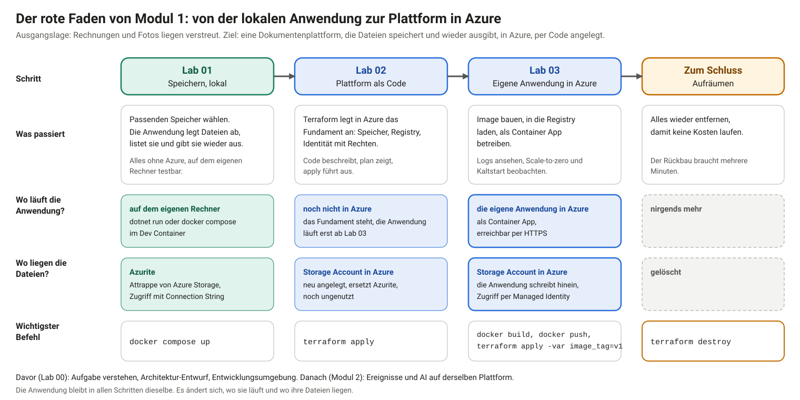
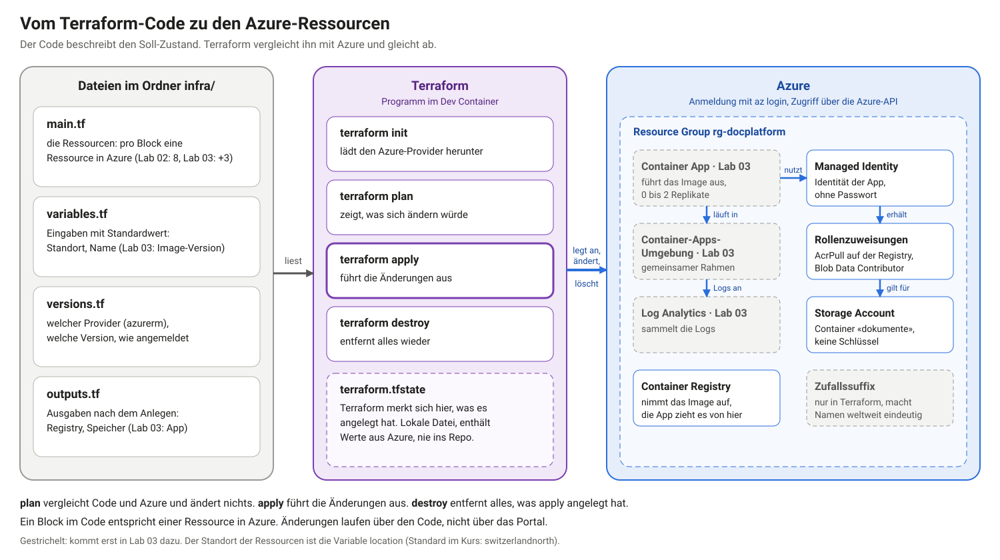
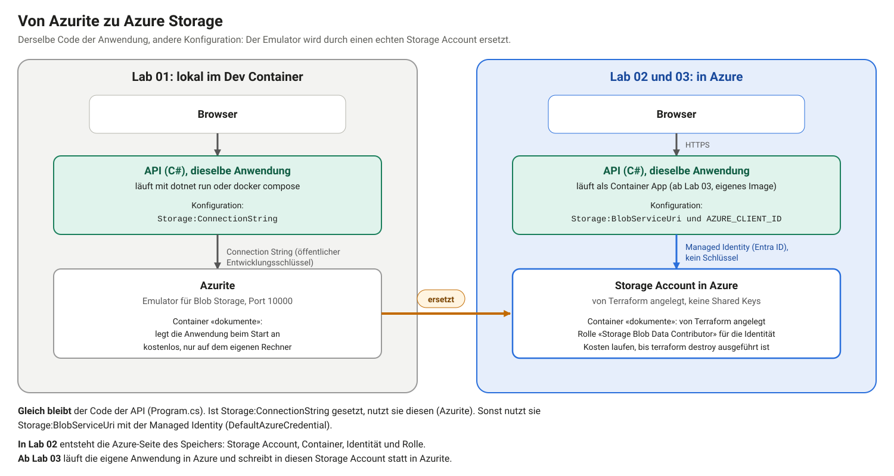

# Lab 02: Infrastruktur als Code mit Terraform

## Schwerpunkte

Dieses Lab legt das Fundament der Plattform in Azure als Code an: Speicher, Registry und eine Identität mit Rechten. Im Mittelpunkt stehen Infrastructure as Code, der Zugriff ohne Schlüssel und der Ablauf `plan`, `apply`, `destroy`.

## Lernziele

- eine Cloud-Umgebung mit Terraform deklarativ beschreiben, planen, anwenden und entfernen
- Ressourcen und ihre Abhängigkeiten lesen: Resource Group, Storage Account, Container Registry, Managed Identity, Rollenzuweisungen
- Zugriffe ohne Schlüssel einrichten: Managed Identity statt Connection String
- Variablen und Outputs einsetzen
- Kosten im Blick behalten: Alles Angelegte lässt sich mit einem Befehl wieder entfernen

## Einordnung im Ablauf

Modul 1 baut in vier Schritten eine Dokumentenplattform. Dieses Lab ist der zweite Schritt.



Bisher (Lab 01): Die Anwendung läuft lokal, ihre Dateien liegen in Azurite.

Dieses Lab: Terraform legt in Azure das Fundament an: einen Storage Account, der Azurite ersetzt, eine Registry für das Image der Anwendung und eine Identität mit den nötigen Rechten. Die Anwendung läuft in Azure noch nicht.

Danach (Lab 03): Die Anwendung wird zu einem Image gebaut, in die Registry geladen und als Container App betrieben.

## Anwendungsfall

Ist-Zustand: Die Dokumentenplattform läuft lokal gegen Azurite (Lab 01).

Problem: Die Plattform steht nur auf dem eigenen Rechner. Manuell im Portal angelegte Ressourcen lassen sich nicht nachvollziehen, nicht wiederholen und nicht sauber entfernen. Die Anforderungen aus Lab 00 (N1 Time to Market, N2 minimale Kosten ohne Nutzung) verlangen eine Plattform, die sich per Befehl anlegen und vollständig zurückbauen lässt.

Ziel: Das Fundament der Plattform ist als Code beschrieben: Storage Account mit Container «dokumente», Container Registry, Managed Identity mit Rollen. Ein Befehl legt es an, ein Befehl entfernt es.



## Von Azurite zu Azure Storage

Mit Lab 02 und Lab 03 ersetzt ein Storage Account in Azure den Emulator Azurite aus Lab 01. Der Code der Anwendung bleibt gleich, die Konfiguration wechselt.



| | Lab 01, lokal | Lab 02 und 03, Azure |
|---|---|---|
| Speicher | Azurite, Emulator im Container, Port 10000 | Storage Account in Azure, von Terraform angelegt |
| Container «dokumente» | legt die Anwendung beim Start an | legt Terraform an |
| Zugriff | Connection String mit dem öffentlichen Entwicklungsschlüssel | Managed Identity mit der Rolle `Storage Blob Data Contributor`, kein Schlüssel |
| Konfiguration | `Storage:ConnectionString` | `Storage:BlobServiceUri` und `AZURE_CLIENT_ID` |
| Anwendung läuft | `dotnet run` oder `docker compose` | Container App (Lab 03) |

Die Auswahl trifft die Anwendung selbst: Ist `Storage:ConnectionString` gesetzt, nutzt sie Azurite. Andernfalls nutzt sie `Storage:BlobServiceUri` mit der Managed Identity.

In Lab 02 entsteht die Azure-Seite des Speichers: Storage Account, Container, Identität und Rolle. Die Anwendung läuft in Azure erst ab Lab 03 und nutzt dann diesen Speicher.

## Anforderungen

Funktional

- F1: Die Plattform ist in Terraform-Dateien beschrieben: Resource Group, Storage Account mit Container «dokumente», Container Registry, User-Assigned Managed Identity mit Rollen.
- F2: `terraform plan` zeigt vor jeder Änderung, was angelegt, geändert oder gelöscht wird.
- F3: `terraform apply` legt das Fundament an. Die Ressourcen sind im Portal und mit der Azure CLI sichtbar.
- F4: `terraform destroy` entfernt alles, was `apply` angelegt hat.

Nicht-funktional

- N1: Globale Namen (Storage Account, Registry) sind eindeutig und kollidieren nicht mit anderen Teilnehmenden (Zufallssuffix).
- N2: Die Plattform enthält keine Schlüssel. Der Storage Account erlaubt keine Shared Keys, die Registry keinen Admin-Benutzer. Die Anwendung greift mit einer Managed Identity zu.
- N3: Zustand (State) und Zugangsdaten gehören nicht ins Repo.
- N4: Nach dem Lab ist alles entfernt, damit keine Kosten weiterlaufen.

Nicht im Scope: gemeinsamer Remote-State, Netzwerk-Isolation, eigene Domain, Skalierung über die Voreinstellung hinaus.

## Voraussetzungen

| Voraussetzung | Prüfung |
|---|---|
| Lab 00 abgeschlossen, Azure-Anmeldung eingerichtet | `bash /workspaces/cas-se-labs/labs/00-setup/check.sh` im Terminal des Dev Containers meldet im Azure-Block `[ok]` |
| Lab 02 im eigenen Repo vorhanden | Ordner `labs/02-iac` besteht, sonst **Sync fork** (Lab 00, «Spätere Labs übernehmen») |
| Azure-Abo mit Rolle Owner | `az account show` nennt das Abo |

Ohne Azure-Abo lassen sich Aufgabe 1, `terraform init` aus Aufgabe 2 und die Aufgaben 3 bis 5 bis zu `terraform validate` durcharbeiten. Anlegen und Entfernen (Aufgabe 6 und «Aufräumen») zeigt dann die Demo.

## Projektstand

Der Ordner `labs/02-iac` enthält zwei Stände.

- `start/` ist die Anwendung aus Lab 01 (`api/`, `docker-compose.yml`) mit einem Terraform-Ordner `infra/`. Darin sind `versions.tf` und `variables.tf` fertig, `main.tf` enthält nur Kommentare mit der Reihenfolge der Aufgaben.
- `solution/` ist die fertige Referenz mit dem vollständigen `infra/` des Fundaments. Im Demo-Modus, also beim Mitverfolgen der Demo ohne eigene Änderungen am Code, wird `solution/` gestartet.

Selbstständig wird in `start/infra` gearbeitet, im Demo-Modus in `solution/infra`.

Alle Befehle dieses Labs laufen im Terminal des Dev Containers (Tab `bash`, Pfad `/workspaces/...` in der Eingabeaufforderung, **Terminal → New Terminal**) und im gewählten Ordner. Zeigt die Eingabeaufforderung `PS /workspaces/...`, ist eine PowerShell geöffnet: im Terminal-Bereich neben dem `+` den Pfeil öffnen und **bash** wählen. Ein Terminal, das noch im Ordner von Lab 01 steht, braucht den Wechsel. Der volle Pfad funktioniert aus jedem Ordner:

```bash
cd /workspaces/cas-se-labs/labs/02-iac/start/infra      # selbstständig
cd /workspaces/cas-se-labs/labs/02-iac/solution/infra   # Demo-Modus
```

Die Dateien (`main.tf`, `outputs.tf`) werden im Editor von VS Code geöffnet und bearbeitet: im Explorer links den Ordner `labs/02-iac/start/infra` aufklappen und die Datei anklicken. Einfügen und Speichern (`Ctrl+S`) geschehen dort, nicht im Terminal.

Die Aufgaben sind in beiden Modi dieselben, nur die Arbeit daran unterscheidet sich:

| Aufgabe | Übung (`start/infra`) | Demo-Modus (`solution/infra`) |
|---|---|---|
| 1: Projektaufbau lesen | lesen | lesen |
| 2: Anmelden, Provider registrieren, initialisieren | ausführen | ausführen |
| 3: Resource Group und eindeutige Namen | Block in `main.tf` einfügen, `fmt` und `validate` | nur lesen, `main.tf` ist fertig |
| 4: Storage Account und Container | Block einfügen, `fmt` und `validate` | nur lesen |
| 5: Registry, Identität und Rollen | Block einfügen, `fmt` und `validate` | nur lesen |
| 6: Planen, anlegen, prüfen | `outputs.tf` anlegen, dann `plan`, `apply`, prüfen | `outputs.tf` ist fertig, ab Schritt 2 ausführen |
| Aufräumen | ausführen | ausführen |

Im Demo-Modus folgt auf Aufgabe 2 also direkt Aufgabe 6. `terraform fmt` und `terraform validate` entfallen, weil sie zu den Aufgaben 3 bis 5 gehören. `terraform plan` und `terraform apply` prüfen die Konfiguration vor dem Ausführen selbst.

## Umgebung öffnen: Variante A, B, C

Übung und Demo-Modus laufen in allen drei Varianten gleich. Die Aufgaben sind identisch. Die Varianten unterscheiden sich nur darin, wie die Umgebung geöffnet wird. Die Einrichtung selbst steht in Lab 00.

| | Variante A: Codespace im Browser | Variante B: Codespace in VS Code | Variante C: lokaler Dev Container |
|---|---|---|---|
| Umgebung öffnen | `github.com/codespaces`, den bestehenden Codespace wählen (Lab 00, Anhang A) | VS Code, **F1 → Codespaces: Connect to Codespace** (Lab 00, Anhang B) | Docker Desktop starten, den Ordner `cas-se-labs` in VS Code öffnen, **Reopen in Container** (Lab 00, Anhang C) |
| Terminal | **Terminal → New Terminal** | **Terminal → New Terminal** | **Terminal → New Terminal** |
| Ordner | `cd labs/02-iac/start/infra` (Übung) oder `cd labs/02-iac/solution/infra` (Demo-Modus) | wie A | wie A |
| Anmeldung | `az login --use-device-code`, den Code im Browser des eigenen Rechners eingeben | wie A | wie A |
| Portal | `portal.azure.com` im eigenen Browser | wie A | wie A |
| Danach | Codespace stoppen (Lab 00, «Aufräumen») | Codespace stoppen | Dev Container schliessen: **F1 → Dev Containers: Reopen Folder Locally** |

## Aufgabe 1: Projektaufbau lesen

Terraform liest alle `.tf`-Dateien eines Ordners als eine Beschreibung. Die Dateinamen dienen nur der Ordnung. Terraform bestimmt die Reihenfolge der Ressourcen selbst aus ihren Abhängigkeiten.

**Ablauf**

Die Dateien in `start/infra` öffnen:

- `versions.tf`: nötige Terraform- und Provider-Versionen, Konfiguration des Azure-Providers
- `variables.tf`: Eingaben `location` und `name`, jeweils mit Standardwert
- `main.tf`: die Ressourcen, zunächst nur Kommentare
- `outputs.tf`: Ausgaben, entsteht in Aufgabe 6

In `versions.tf` steht `storage_use_azuread = true`. Der Storage Account erlaubt später keine Shared Keys. Ohne diese Einstellung greift der Provider mit einem Schlüssel auf den Speicher zu und scheitert (siehe Aufgabe 6).

**Erwartetes Ergebnis**

Die Zuordnung von Datei und Inhalt ist klar. Die Standardwerte in `variables.tf` genügen für dieses Lab.

**Weiterführend**

- [Terraform: Infrastructure as Code auf Azure](https://developer.hashicorp.com/terraform/tutorials/azure-get-started) und [Terraform auf Azure, Übersicht](https://learn.microsoft.com/azure/developer/terraform/overview): Einstieg von HashiCorp und von Microsoft
- [Provider-Anforderungen](https://developer.hashicorp.com/terraform/language/providers/requirements): `required_providers` in `versions.tf`
- [Dependency Lock File](https://developer.hashicorp.com/terraform/language/files/dependency-lock): wofür `.terraform.lock.hcl` dient
- [Variablen](https://developer.hashicorp.com/terraform/language/values/variables): `variables.tf`
- [Azure-Provider: Anmeldung mit der Azure CLI](https://registry.terraform.io/providers/hashicorp/azurerm/latest/docs/guides/azure_cli) und [Provider-Dokumentation](https://registry.terraform.io/providers/hashicorp/azurerm/latest/docs)
- [Zugriff mit Shared Key verhindern](https://learn.microsoft.com/azure/storage/common/shared-key-authorization-prevent): Hintergrund zu `storage_use_azuread`


## Aufgabe 2: Anmelden, Provider registrieren, initialisieren

Terraform meldet sich mit dem Konto der Azure CLI an. Das Abo steht in der Umgebungsvariable `ARM_SUBSCRIPTION_ID`. Die Container Registry gehört zu einem Resource Provider, den ein neues Abo erst registrieren muss.

**Ablauf**

Ort: Terminal des Dev Containers, im Ordner `infra` (siehe «Projektstand»). Die Befehle der Reihe nach:

1. `az login --use-device-code` meldet die Azure CLI an. Das Terminal zeigt einen Link und einen Code. Der Link (`microsoft.com/devicelogin`) wird im Browser geöffnet, dort den Code eingeben und mit dem Konto anmelden, dem das Abo gehört.
2. `export ARM_SUBSCRIPTION_ID=...` speichert die Id des Abos in einer Variable. Terraform liest sie, um zu wissen, in welchem Abo es arbeitet.
3. `az provider register ... --wait` schaltet den Azure-Dienst «Container Registry» im Abo frei. Das ist einmal pro Abo nötig. `--wait` wartet, bis die Freischaltung abgeschlossen ist.
4. `terraform init` bereitet den Ordner vor: Terraform lädt die Provider herunter (das Plug-in für Azure und für Zufallswerte). Es legt noch nichts in Azure an.

```bash
az login --use-device-code
export ARM_SUBSCRIPTION_ID=$(az account show --query id -o tsv)
az provider register --namespace Microsoft.ContainerRegistry --wait
terraform init
```

**Erwartetes Ergebnis**

`terraform init` endet mit «Terraform has been successfully initialized!». Es entsteht ein Ordner `.terraform` und eine Datei `.terraform.lock.hcl`. Der Ordner `.terraform` steht in `.gitignore`.

**Was schiefgehen kann**

- `az login` meldet «No subscriptions found»: Das Konto hat kein aktives Abo (Lab 00, «Bei Azure anmelden»).
- `terraform plan` (Aufgabe 6) meldet «subscription ID could not be determined»: `ARM_SUBSCRIPTION_ID` fehlt in diesem Terminal. `terraform init` braucht die Variable noch nicht. Die Variable gilt nur im Terminal, in dem sie gesetzt wurde.
- `az provider register --wait` dauert länger: Bei einem neuen Abo kann die Registrierung einige Minuten brauchen. Ohne die Registrierung scheitert der Apply später mit `MissingSubscriptionRegistration`.

**Weiterführend**

- [Anmeldung bei der Azure CLI, interaktiv](https://learn.microsoft.com/cli/azure/authenticate-azure-cli-interactively): Gerätecode und Alternativen
- [Resource Provider und Resource Types](https://learn.microsoft.com/azure/azure-resource-manager/management/resource-providers-and-types): warum `az provider register` nötig ist
- [`az provider`](https://learn.microsoft.com/cli/azure/provider): Befehle zum Registrieren und Auflisten
- [`terraform init`](https://developer.hashicorp.com/terraform/cli/commands/init)


## Aufgabe 3: Resource Group und eindeutige Namen

Demo-Modus: Diese Aufgabe wird nur gelesen. `solution/infra/main.tf` enthält die Blöcke bereits. Weiter bei Aufgabe 6.

Eine Resource Group fasst alle Ressourcen der Plattform zusammen. Sie ist der Container, den `destroy` am Ende entfernt. Storage Account und Registry brauchen weltweit eindeutige Namen. Ein Zufallssuffix verhindert Kollisionen zwischen den Teilnehmenden.

**Ablauf**

Die Datei `main.tf` im Editor öffnen (siehe «Projektstand»). Den folgenden Block an das Ende der Datei setzen und mit `Ctrl+S` speichern. `random_string` erzeugt einmalig fünf zufällige Zeichen, `locals` bildet daraus die Namen, `azurerm_resource_group` ist die Resource Group.

```hcl
resource "random_string" "suffix" {
  length  = 5
  upper   = false
  special = false
}

locals {
  suffix = random_string.suffix.result
  # Storage and registry names must be globally unique and contain only lowercase letters and digits
  storage_name  = "st${var.name}${local.suffix}"
  registry_name = "acr${var.name}${local.suffix}"
}

resource "azurerm_resource_group" "main" {
  name     = "rg-${var.name}"
  location = var.location
}
```

Danach im Terminal des Dev Containers, im Ordner `infra`, prüfen. `terraform fmt` richtet die Dateien einheitlich aus (Einrückung), `terraform validate` prüft die Beschreibung auf Fehler, ohne Azure zu berühren:

```bash
terraform fmt
terraform validate
```

Dasselbe gilt für die Prüfungen in den Aufgaben 4 und 5.

**Erwartetes Ergebnis**

`terraform validate` meldet «Success! The configuration is valid.»

**Was schiefgehen kann**

- `Error: Unsupported argument` oder `Unclosed configuration block`: Eine Klammer oder ein Argument fehlt beim Einfügen. `terraform fmt` und die Zeilennummer der Meldung zeigen die Stelle.
- `terraform: command not found`: Das Terminal läuft nicht im Dev Container (Lab 00).

**Weiterführend**

- [Resource Group im Azure-Provider](https://registry.terraform.io/providers/hashicorp/azurerm/latest/docs/resources/resource_group) und [Resource Groups im Portal](https://learn.microsoft.com/azure/azure-resource-manager/management/manage-resource-groups-portal)
- [`random_string`](https://registry.terraform.io/providers/hashicorp/random/latest/docs/resources/string): der Zufallssuffix
- [Locals](https://developer.hashicorp.com/terraform/language/values/locals) und [Verweise auf Ressourcen](https://developer.hashicorp.com/terraform/language/expressions/references): `random_string.suffix.result`, `azurerm_resource_group.main.name`
- [Namensregeln für Azure-Ressourcen](https://learn.microsoft.com/azure/azure-resource-manager/management/resource-name-rules): Länge und erlaubte Zeichen
- [Namenskonvention](https://learn.microsoft.com/azure/cloud-adoption-framework/ready/azure-best-practices/resource-naming) und [Abkürzungen](https://learn.microsoft.com/azure/cloud-adoption-framework/ready/azure-best-practices/resource-abbreviations) im Cloud Adoption Framework: `rg-`, `st`, `acr`, `id-`
- [`terraform fmt`](https://developer.hashicorp.com/terraform/cli/commands/fmt) und [`terraform validate`](https://developer.hashicorp.com/terraform/cli/commands/validate)


## Aufgabe 4: Storage Account und Container

Demo-Modus: Diese Aufgabe wird nur gelesen. `solution/infra/main.tf` enthält die Blöcke bereits. Weiter bei Aufgabe 6.

Der Storage Account hält die Dokumente und ersetzt Azurite aus Lab 01. Er erlaubt weder Shared Keys noch anonymen Zugriff. Der Zugriff erfolgt über Entra ID.

**Ablauf**

Den folgenden Block an das Ende von `main.tf` setzen und prüfen:

```hcl
# --- Storage: no shared keys, no anonymous access. Only Entra ID (Managed Identity) gets in.

resource "azurerm_storage_account" "main" {
  name                     = local.storage_name
  resource_group_name      = azurerm_resource_group.main.name
  location                 = azurerm_resource_group.main.location
  account_tier             = "Standard"
  account_replication_type = "LRS"

  shared_access_key_enabled       = false
  allow_nested_items_to_be_public = false
  min_tls_version                 = "TLS1_2"
}

resource "azurerm_storage_container" "documents" {
  name                  = "dokumente"
  storage_account_id    = azurerm_storage_account.main.id
  container_access_type = "private"
}
```

```bash
terraform fmt
terraform validate
```

**Erwartetes Ergebnis**

`terraform validate` meldet «Success!». Der Container heisst `dokumente`, wie in Lab 01.

**Was schiefgehen kann**

- `Reference to undeclared resource`: Der Block aus Aufgabe 3 fehlt oder ein Name wurde abgeändert (`azurerm_resource_group.main`).

**Weiterführend**

- [`azurerm_storage_account`](https://registry.terraform.io/providers/hashicorp/azurerm/latest/docs/resources/storage_account) und [`azurerm_storage_container`](https://registry.terraform.io/providers/hashicorp/azurerm/latest/docs/resources/storage_container)
- [Übersicht Storage Account](https://learn.microsoft.com/azure/storage/common/storage-account-overview)
- [Zugriff mit Shared Key verhindern](https://learn.microsoft.com/azure/storage/common/shared-key-authorization-prevent): `shared_access_key_enabled = false`
- [Zugriff auf Blobs mit Entra ID autorisieren](https://learn.microsoft.com/azure/storage/blobs/authorize-access-azure-active-directory)
- [Redundanz in Azure Storage](https://learn.microsoft.com/azure/storage/common/storage-redundancy): LRS, ZRS, GRS (Lab 01, Aufgabe 1)
- [Netzwerksicherheit für Storage](https://learn.microsoft.com/azure/storage/common/storage-network-security): nicht Teil dieses Labs


## Aufgabe 5: Registry, Identität und Rollen

Demo-Modus: Diese Aufgabe wird nur gelesen. `solution/infra/main.tf` enthält die Blöcke bereits. Weiter bei Aufgabe 6.

Die Container Registry nimmt das Image der Anwendung auf. Eine User-Assigned Managed Identity ist die Identität der Anwendung. Rollenzuweisungen geben ihr genau die Rechte, die sie braucht: Images ziehen (`AcrPull`) und Blobs lesen und schreiben (`Storage Blob Data Contributor`, nur auf dem Container `dokumente`).

**Ablauf**

Den folgenden Block an das Ende von `main.tf` setzen und prüfen:

```hcl
# --- Registry: no admin user, the app pulls with its identity (AcrPull)

resource "azurerm_container_registry" "main" {
  name                = local.registry_name
  resource_group_name = azurerm_resource_group.main.name
  location            = azurerm_resource_group.main.location
  sku                 = "Basic"
  admin_enabled       = false
}

# --- Identity of the app. User-assigned so that the roles exist before the app starts.

resource "azurerm_user_assigned_identity" "app" {
  name                = "id-${var.name}-app"
  resource_group_name = azurerm_resource_group.main.name
  location            = azurerm_resource_group.main.location
}

resource "azurerm_role_assignment" "app_acr_pull" {
  scope                = azurerm_container_registry.main.id
  role_definition_name = "AcrPull"
  principal_id         = azurerm_user_assigned_identity.app.principal_id
}

# Scope is the single container, not the whole account
resource "azurerm_role_assignment" "app_blob" {
  scope                = azurerm_storage_container.documents.id
  role_definition_name = "Storage Blob Data Contributor"
  principal_id         = azurerm_user_assigned_identity.app.principal_id
}
```

```bash
terraform fmt
terraform validate
```

**Erwartetes Ergebnis**

`terraform validate` meldet «Success!». Die Registry hat keinen Admin-Benutzer, die Anwendung zieht Images mit ihrer Identität.

**Was schiefgehen kann**

- `Reference to undeclared resource`: Der Block aus Aufgabe 4 fehlt, die Rolle verweist auf `azurerm_storage_container.documents`.

**Weiterführend**

- [`azurerm_container_registry`](https://registry.terraform.io/providers/hashicorp/azurerm/latest/docs/resources/container_registry), [`azurerm_user_assigned_identity`](https://registry.terraform.io/providers/hashicorp/azurerm/latest/docs/resources/user_assigned_identity) und [`azurerm_role_assignment`](https://registry.terraform.io/providers/hashicorp/azurerm/latest/docs/resources/role_assignment)
- [Azure Container Registry](https://learn.microsoft.com/azure/container-registry/container-registry-intro), [Service-Tiers](https://learn.microsoft.com/azure/container-registry/container-registry-skus) und [Preise](https://azure.microsoft.com/pricing/details/container-registry/)
- [Authentifizierung bei der Registry](https://learn.microsoft.com/azure/container-registry/container-registry-authentication) und [mit einer Managed Identity](https://learn.microsoft.com/azure/container-registry/container-registry-authentication-managed-identity): Admin-Benutzer, `AcrPull`
- [Managed Identities](https://learn.microsoft.com/entra/identity/managed-identities-azure-resources/overview) und [Empfehlungen zu User-Assigned und System-Assigned](https://learn.microsoft.com/entra/identity/managed-identities-azure-resources/managed-identity-best-practice-recommendations)
- [Azure RBAC, Übersicht](https://learn.microsoft.com/azure/role-based-access-control/overview), [eingebaute Rollen](https://learn.microsoft.com/azure/role-based-access-control/built-in-roles) und [Rollen im Portal zuweisen](https://learn.microsoft.com/azure/role-based-access-control/role-assignments-portal)


## Aufgabe 6: Planen, anlegen, prüfen

`plan` vergleicht die Beschreibung mit dem, was bereits besteht, und zeigt die Änderungen. `apply` führt sie aus und schreibt den Zustand in die Datei `terraform.tfstate`. Outputs geben Werte aus, die nach dem Anlegen bekannt sind, zum Beispiel den Namen der Registry.

**Ablauf**

Demo-Modus: Schritt 1 entfällt, `outputs.tf` besteht in `solution/infra`. Weiter bei Schritt 2.

Die Befehle laufen im Terminal des Dev Containers, im Ordner `infra`. `outputs.tf` entsteht im Editor von VS Code: im Explorer Rechtsklick auf den Ordner `infra`, **New File**, Name `outputs.tf`.

1. Die Datei `outputs.tf` mit diesem Inhalt anlegen:

   ```hcl
   output "registry_name" {
     value = azurerm_container_registry.main.name
   }

   output "registry_login_server" {
     value = azurerm_container_registry.main.login_server
   }

   output "storage_account_name" {
     value = azurerm_storage_account.main.name
   }

   output "resource_group" {
     value = azurerm_resource_group.main.name
   }
   ```

2. Den Plan ansehen. `terraform plan` vergleicht den Code mit dem, was in Azure besteht, und listet auf, was angelegt würde. Es ändert nichts:

   ```bash
   terraform plan
   ```

3. Anlegen. `terraform apply` zeigt den Plan erneut und fragt nach einer Bestätigung. Mit `yes` beginnt das Anlegen in Azure, es dauert einige Minuten:

   ```bash
   terraform apply
   ```

4. Die Ausgaben und die angelegten Ressourcen ansehen. `terraform output` zeigt die Werte aus `outputs.tf`, `az resource list` listet die Ressourcen der Resource Group aus Sicht von Azure, `terraform state show` zeigt die Einstellung des Storage Accounts im Zustand von Terraform:

   ```bash
   terraform output
   az resource list --resource-group rg-docplatform --query "[].{Name:name, Type:type}" -o table
   terraform state show azurerm_storage_account.main | grep shared_access_key_enabled
   ```

5. Prüfen, dass der Zustand dem Code entspricht. Ein zweiter `terraform plan` darf nichts mehr ändern wollen:

   ```bash
   terraform plan
   ```

**Erwartetes Ergebnis**

- Der erste Plan endet mit «Plan: 8 to add, 0 to change, 0 to destroy.»
- Der Apply endet mit «Apply complete! Resources: 8 added.» Die Resource Group `rg-docplatform` besteht im Portal.
- `az resource list` nennt Storage Account, Container Registry und Managed Identity. Der Container «dokumente» liegt im Storage Account und ist im Portal unter «Data storage» sichtbar.
- Die Ausgabe lautet `shared_access_key_enabled = false`: Der Storage Account erlaubt keine Shared Keys.
- Der zweite Plan meldet «No changes. Your infrastructure matches the configuration.»

**Was schiefgehen kann**

- Der Apply bricht beim Storage Account mit `KeyBasedAuthenticationNotPermitted` (403) ab: In `versions.tf` fehlt `storage_use_azuread = true`. Der Provider versucht sonst, auf die Datenebene des Speichers mit einem Schlüssel zuzugreifen, den der Account nicht zulässt. Nach dem Ergänzen den Apply wiederholen, Terraform setzt dort fort, wo es abgebrochen hat.
- `MissingSubscriptionRegistration` für `Microsoft.ContainerRegistry`: Die Registrierung aus Aufgabe 2 fehlt. Nachholen und den Apply wiederholen.
- `PrincipalNotFound` bei einer Rollenzuweisung: Die neue Identität ist in Entra ID noch nicht überall bekannt. Ein erneuter `terraform apply` setzt fort.
- `AuthorizationFailed` bei einer Rollenzuweisung: Das Konto hat im Abo nicht die Rolle Owner. Rollenzuweisungen verlangen Owner oder User Access Administrator.
- Namenskonflikt beim Storage Account oder bei der Registry: Zufallssuffix und Präfix `name` sind im Code vorgesehen. Bei einem Konflikt erzeugt `terraform apply -replace=random_string.suffix` einen neuen Suffix. Weil alle Namen davon abgeleitet sind, werden Storage Account und Registry dabei ersetzt.

**Weiterführend**

- Befehle: [`plan`](https://developer.hashicorp.com/terraform/cli/commands/plan), [`apply`](https://developer.hashicorp.com/terraform/cli/commands/apply) (darin die Option `-replace`), [`output`](https://developer.hashicorp.com/terraform/cli/commands/output), [`state show`](https://developer.hashicorp.com/terraform/cli/commands/state/show)
- [State in Terraform](https://developer.hashicorp.com/terraform/language/state): wofür `terraform.tfstate` dient
- [Outputs](https://developer.hashicorp.com/terraform/language/values/outputs): Werte nach dem Anlegen ausgeben
- [Remote State in Azure Storage](https://learn.microsoft.com/azure/developer/terraform/store-state-in-azure-storage): Zustand gemeinsam im Team nutzen (nicht Teil dieses Labs)
- [Resource Groups im Portal](https://learn.microsoft.com/azure/azure-resource-manager/management/manage-resource-groups-portal): die angelegten Ressourcen ansehen
- [`az resource`](https://learn.microsoft.com/cli/azure/resource): Ressourcen mit der Azure CLI listen
- [Kostenanalyse im Portal](https://learn.microsoft.com/azure/cost-management-billing/costs/quick-acm-cost-analysis): Kosten der Resource Group verfolgen

## Aufräumen

Aufgeräumt wird auch dann, wenn gleich Lab 03 folgt. Lab 03 legt das Fundament in Aufgabe 1 selbst neu an, mit dem Terraform-Code in seinem eigenen Ordner. Der Zustand (State) eines Labs liegt in dessen Ordner. Besteht die Resource Group `rg-docplatform` noch aus Lab 02, meldet Lab 03 beim `apply` «already exists» und «needs to be imported». Das Neuanlegen dauert wenige Minuten. In einer Demo mit Lab 02 und Lab 03 hintereinander steht deshalb zwischen beiden `terraform destroy`.

Ort: Terminal des Dev Containers, im Ordner `infra`. `terraform destroy` entfernt alles, was `apply` angelegt hat:

```bash
terraform destroy
```

Terraform fragt nach einer Bestätigung (`yes`). Danach ist die Resource Group entfernt.

Zur Kontrolle, ebenfalls im Terminal des Dev Containers (der Befehl fragt Azure nach der Resource Group):

```bash
az group list --query "[?name=='rg-docplatform']" -o tsv
```

Die Ausgabe ist leer.

**Weiterführend**

- [`terraform destroy`](https://developer.hashicorp.com/terraform/cli/commands/destroy)
- [Resource Group löschen](https://learn.microsoft.com/azure/azure-resource-manager/management/delete-resource-group): was mit den Ressourcen darin geschieht


## Definition of Done

- [ ] `main.tf` enthält alle Ressourcen aus den Aufgaben 3 bis 5, `terraform validate` meldet «Success!».
- [ ] F3: `terraform apply` hat 8 Ressourcen angelegt («Apply complete! Resources: 8 added.»), `az resource list` zeigt Storage Account, Container Registry und Managed Identity.
- [ ] F2: Ein erneuter `terraform plan` meldet «No changes».
- [ ] N2: Im Code steht kein Schlüssel, kein Passwort und kein Connection String.
- [ ] F4, N4: `terraform destroy` ist erfolgt, die Resource Group `rg-docplatform` besteht nicht mehr.
- [ ] Die eigene Lösung ist mit `solution/infra` verglichen, Abweichungen sind erklärt.

## Nächste Schritte

Lab 03 («Container bauen und betreiben») baut das Image der Anwendung, legt es in die Registry und betreibt es als Container App auf diesem Fundament. Der Stand aus `solution/` bildet den Ausgangspunkt von Lab 03.

## Hinweise

- `terraform.tfstate` enthält den gesamten Zustand, darunter Werte, die nicht im Code stehen. Die Datei gehört nicht ins Repo und steht in `.gitignore`. Für die Arbeit im Team ist ein gemeinsamer Remote-State nötig.
- Terraform legt nur an, was im Code steht. Änderungen im Portal an diesen Ressourcen zeigt der nächste `plan` als Abweichung. Der Code bleibt die Quelle.
- Fixkosten entstehen in diesem Lab vor allem durch die Container Registry (Basic). Der Storage Account kostet ohne Daten praktisch nichts.
