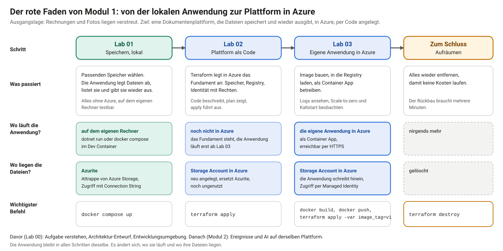

# Lab 03: Container bauen und betreiben

## Schwerpunkte

Dieses Lab bringt die Anwendung aus Lab 01 in die Cloud: Image bauen, in die Registry laden und als Container App auf dem Fundament aus Lab 02 betreiben. Die Anwendung greift ohne Schlüssel auf den Speicher zu. Dazu kommen Logs und das Verhalten beim Skalieren auf null.

## Lernziele

- ein Container-Image der Anwendung bauen und in eine private Registry laden
- eine Container App mit Terraform beschreiben und dafür die Image-Version als Variable führen
- prüfen, dass die Anwendung in Azure mit ihrer Managed Identity auf den Speicher zugreift
- Logs einer Container App abrufen
- Scale-to-zero und Kaltstart beobachten und einordnen

## Einordnung im Ablauf

Modul 1 baut in vier Schritten eine Dokumentenplattform. Dieses Lab ist der dritte Schritt.



Bisher: In Lab 01 lief die Anwendung lokal mit Azurite. In Lab 02 hat Terraform das Fundament in Azure angelegt: Storage Account, Registry und Identität.

Dieses Lab: Die Anwendung wird zu einem Image gebaut, in die Registry geladen und als Container App betrieben. Ab jetzt schreibt sie in den Storage Account statt in Azurite.

Danach: `terraform destroy` entfernt alles wieder. Modul 2 baut auf derselben Plattform auf.

## Anwendungsfall

Ist-Zustand: Das Fundament steht als Code (Lab 02). Die Anwendung aus Lab 01 läuft nur lokal.

Problem: Die Anwendung läuft noch nicht in Azure. Eine Container App startet ein Image aus einer Registry. Dieses Image existiert noch nicht.

Ziel: Die Dokumentenplattform läuft in Azure unter einer HTTPS-Adresse. Hochladen, Auflisten und Herunterladen funktionieren wie lokal, der Zugriff auf den Speicher läuft über die Managed Identity.

## Anforderungen

Funktional

- F1: Das Image der Anwendung liegt in der Container Registry der Plattform.
- F2: Eine Container App läuft mit diesem Image, beschrieben in Terraform. Hochladen, Auflisten und Herunterladen funktionieren über die HTTPS-Adresse.
- F3: Der Zugriff auf den Speicher erfolgt mit der Managed Identity der Anwendung, ohne Schlüssel und ohne Connection String.
- F4: Die Logs der Anwendung sind abrufbar.

Nicht-funktional

- N1: Die Image-Version ist eine Variable in Terraform. Eine neue Version ist ein `apply`, kein Eingriff im Portal.
- N2: Ohne Zugriffe läuft kein Container (Scale-to-zero). Der erste Zugriff danach dauert länger (Kaltstart).
- N3: Nach dem Lab ist alles entfernt.

Nicht im Scope: Image-Scan, mehrere Umgebungen, eigene Domain.

## Voraussetzungen

| Voraussetzung | Prüfung |
|---|---|
| Lab 02 abgeschlossen und aufgeräumt | `terraform destroy` ist erfolgt, in dem Ordner, in dem Lab 02 angewendet wurde (`start/infra` oder `solution/infra`) |
| Lab 03 im eigenen Repo vorhanden | Ordner `labs/03-container` besteht, sonst **Sync fork** (Lab 00, «Spätere Labs übernehmen») |
| Anmeldung bei Azure | `az account show` nennt das Abo. `ARM_SUBSCRIPTION_ID` gilt nur im Terminal, in dem sie gesetzt wurde (Aufgabe 1) |
| Docker läuft im Dev Container | `docker info` zeigt unter «Server» eine Version |

Alle Befehle dieses Labs laufen im Terminal des Dev Containers (Tab `bash`, Pfad `/workspaces/...` in der Eingabeaufforderung, **Terminal → New Terminal**) und im Ordner `labs/03-container/start/infra`. Ein Terminal, das noch in einem Ordner von Lab 01 oder 02 steht, braucht den Wechsel. Der volle Pfad funktioniert aus jedem Ordner: `cd /workspaces/cas-se-labs/labs/03-container/start/infra`. Zeigt die Eingabeaufforderung `PS /workspaces/...`, ist eine PowerShell geöffnet: im Terminal-Bereich neben dem `+` den Pfeil öffnen und **bash** wählen.

Variablen wie `REGISTRY` und `URL` gelten nur im Terminal, in dem sie gesetzt wurden, und sind in einem neuen Terminal neu zu setzen. Dateien wie `main.tf` werden im Editor von VS Code bearbeitet: im Explorer links den Ordner `labs/03-container/start/infra` aufklappen und die Datei anklicken. Einfügen und Speichern (`Ctrl+S`) geschehen dort, nicht im Terminal.

Der Ordner `labs/03-container` enthält zwei Stände. `start/` ist der Stand aus Lab 02 (Anwendung und `infra/` mit dem Fundament). `solution/` ist die Referenz mit den Ergänzungen aus Aufgabe 4. Gearbeitet wird in beiden Modi in `start/infra`. `solution/infra` dient in der Übung zum Vergleichen und im Demo-Modus als Quelle der fertigen Dateien.

| Aufgabe | Übung | Demo-Modus |
|---|---|---|
| 1: Fundament anlegen | ausführen | ausführen |
| 2: Image bauen | ausführen | ausführen |
| 3: Image in die Registry laden | ausführen | ausführen |
| 4: Container App in Terraform beschreiben | Blöcke in `variables.tf`, `main.tf` und `outputs.tf` einfügen, `fmt` und `validate` | die drei fertigen Dateien aus `solution/infra` kopieren (ein Befehl), `validate` |
| 5 bis 7 | ausführen | ausführen |
| Aufräumen | ausführen | ausführen |

Im Demo-Modus liegt der Unterschied nur in Aufgabe 4. Das Fundament in Aufgabe 1 hat 8 Ressourcen, die Container App aus Aufgabe 4 ergänzt 3. Deshalb funktioniert `solution/infra` nicht von Anfang an: Es würde in Aufgabe 1 schon die Container App anlegen wollen, und das Image dafür existiert noch nicht.

## Aufgabe 1: Fundament anlegen

Die Registry muss existieren, bevor ein Image hochgeladen werden kann. Terraform legt dazu das Fundament an, wie in Lab 02. Die Resource Provider für Container Apps und Log Analytics werden hier gleich mit registriert, weil Aufgabe 5 sie braucht.

**Ablauf**

Ort: Terminal des Dev Containers. Die Befehle der Reihe nach:

1. `cd ...` wechselt in den Ordner mit dem Terraform-Code.
2. `export ARM_SUBSCRIPTION_ID=...` speichert die Id des Abos in einer Variable, die Terraform liest. Das Terminal muss bei Azure angemeldet sein (`az account show` nennt das Abo, sonst `az login --use-device-code`, Lab 02, Aufgabe 2).
3. Die drei `az provider register ...` schalten die Azure-Dienste Container Registry, Container Apps und Log Analytics im Abo frei. Das ist einmal pro Abo nötig. `--wait` wartet, bis die Freischaltung abgeschlossen ist.
4. `terraform init` lädt die Provider, `terraform apply` legt das Fundament an (8 Ressourcen).

```bash
cd /workspaces/cas-se-labs/labs/03-container/start/infra
export ARM_SUBSCRIPTION_ID=$(az account show --query id -o tsv)
az provider register --namespace Microsoft.ContainerRegistry --wait
az provider register --namespace Microsoft.App --wait
az provider register --namespace Microsoft.OperationalInsights --wait
terraform init
terraform apply
```

`terraform apply` zeigt den Plan und fragt nach einer Bestätigung. Mit `yes` beginnt das Anlegen. Danach geben die zwei Befehle die Namen der Registry aus, die in den Aufgaben 2 und 3 gebraucht werden:

```bash
terraform output registry_name
terraform output registry_login_server
```

**Erwartetes Ergebnis**

Der Apply endet mit «Apply complete! Resources: 8 added.» Die Ausgabe nennt einen Registry-Namen wie `acrdocplatformxxxxx` und einen Login-Server `acrdocplatformxxxxx.azurecr.io`.

**Was schiefgehen kann**

- Fehler zu `MissingSubscriptionRegistration` oder `KeyBasedAuthenticationNotPermitted`: siehe Lab 02, Aufgabe 2 und 6.
- Terraform meldet, dass `rg-docplatform` bereits besteht und importiert werden müsste (`already exists`, `needs to be imported`): Die Plattform aus Lab 02 besteht noch. Im Ordner von Lab 02 (`labs/02-iac/start/infra` oder `labs/02-iac/solution/infra`) `terraform destroy` ausführen.

## Aufgabe 2: Image bauen

Ein Image ist das gepackte Programm mit allem, was es zum Laufen braucht. Das `Dockerfile` in `api/` beschreibt den Bau in zwei Stufen: Übersetzen mit dem .NET SDK, Ausführen mit der kleineren ASP.NET-Laufzeit. Der Name des Images beginnt mit dem Login-Server der Registry, damit Docker weiss, wohin es gehört.

**Ablauf**

Ort: Terminal des Dev Containers, Ordner `labs/03-container/start/infra`. `REGISTRY=...` merkt sich den Login-Server der Registry in einer Variable. `docker build` baut das Image aus dem Dockerfile in `../api` und gibt ihm den Namen `<Login-Server>/api:v1`. `--platform linux/amd64` legt die Prozessor-Architektur fest, `-t` vergibt Name und Tag. `docker images` listet das Ergebnis. Der erste Bau dauert einige Minuten, weil Docker die Basis-Images lädt.

```bash
REGISTRY=$(terraform output -raw registry_login_server)
docker build --platform linux/amd64 -t "$REGISTRY/api:v1" ../api
docker images "$REGISTRY/api"
```

**Erwartetes Ergebnis**

`docker build` endet ohne Fehler. `docker images` zeigt das Image `…/api` mit dem Tag `v1`.

**Was schiefgehen kann**

- `Cannot connect to the Docker daemon`: Docker läuft nicht (Lab 01, Aufgabe 2).
- Die Container App startet später nicht und meldet `exec format error`: Das Image wurde für eine andere Prozessor-Architektur gebaut, etwa auf einem Mac mit Apple Silicon. Container Apps führen `linux/amd64` aus. Die Option `--platform linux/amd64` im Befehl legt das fest.
- `docker build` bricht beim Herunterladen der Basis-Images ab: Das Netzwerk blockiert `mcr.microsoft.com`. Ein anderes Netz oder ein Codespace löst das.

**Weiterführend**

- [Was ist ein Image?](https://docs.docker.com/get-started/docker-concepts/the-basics/what-is-an-image/) und [Multi-Stage-Builds](https://docs.docker.com/build/building/multi-stage/): Aufbau des `Dockerfile` in zwei Stufen
- [`docker build`](https://docs.docker.com/reference/cli/docker/image/build/): Optionen `-t` und `--platform`
- [ASP.NET-Core-Images bauen](https://learn.microsoft.com/aspnet/core/host-and-deploy/docker/building-net-docker-images) und [.NET-App containerisieren](https://learn.microsoft.com/dotnet/core/docker/build-container)

## Aufgabe 3: Image in die Registry laden

Die Registry ist privat. Der Login mit der Azure CLI holt ein kurzlebiges Token auf Basis der Anmeldung bei Azure, der Registry-Admin bleibt abgeschaltet (Lab 02, N2). Das Image wird lokal gebaut und hochgeladen. `az acr build`, der Bau in der Cloud, steht mit dem Gratisguthaben eines Testabos nicht zur Verfügung (laut Microsoft Learn, Stand 05.11.2026): Microsoft pausiert dort die ACR-Task-Läufe, der Befehl endet mit `TasksOperationsNotAllowed`.

**Ablauf**

Ort: Terminal des Dev Containers, Ordner `labs/03-container/start/infra`. Die Variable `REGISTRY` wird neu gesetzt, falls das Terminal gewechselt wurde. `az acr login` meldet Docker bei der Registry an. `docker push` lädt das Image hoch. `az acr repository show-tags` fragt die Registry, welche Tags im Repository `api` liegen:

```bash
REGISTRY=$(terraform output -raw registry_login_server)
az acr login --name "$(terraform output -raw registry_name)"
docker push "$REGISTRY/api:v1"
az acr repository show-tags --name "$(terraform output -raw registry_name)" --repository api -o tsv
```

**Erwartetes Ergebnis**

`az acr login` meldet «Login Succeeded». `docker push` endet mit dem Digest der Version. Die letzte Ausgabe lautet `v1`.

**Was schiefgehen kann**

- `unauthorized` oder `denied` beim Push: Die Anmeldung ist abgelaufen oder gehört zu einem anderen Abo. `az login` und `az acr login` wiederholen.
- `docker push` bricht beim Hochladen ab: Das Netzwerk blockiert `*.azurecr.io`.
- `az acr build` verwenden (`TasksOperationsNotAllowed`): Im Testabo nicht möglich, siehe oben. Bau und Push erfolgen lokal.

**Weiterführend**

- [Image in die Registry laden mit Docker CLI](https://learn.microsoft.com/azure/container-registry/container-registry-get-started-docker-cli): `az acr login`, `docker push`
- [`az acr`](https://learn.microsoft.com/cli/azure/acr): Befehlsübersicht
- [`docker push`](https://docs.docker.com/reference/cli/docker/image/push/)
- [ACR Tasks, Übersicht](https://learn.microsoft.com/azure/container-registry/container-registry-tasks-overview): Bau in der Cloud (`az acr build`)

## Aufgabe 4: Container App in Terraform beschreiben

Die Container App läuft in einer Container-Apps-Umgebung, Log Analytics sammelt die Logs. Die App startet das Image `api` aus der Registry. Welche Version, steht in der Variable `image_tag`. Die Umgebungsvariablen geben der Anwendung die Adresse des Speichers und die Client-ID der Identität. Ohne die Client-ID wüsste die Anwendung bei mehreren Identitäten nicht, welche sie nutzen soll. Diese Konfiguration ersetzt den Connection String aus Lab 01.

**Ablauf**

Demo-Modus: Die Blöcke werden nicht eingefügt. Ein Befehl kopiert die drei fertigen Dateien aus `solution/infra` nach `start/infra` und überschreibt dort die vorhandenen. Ort: Terminal des Dev Containers, Ordner `labs/03-container/start/infra`:

```bash
cp ../../solution/infra/main.tf ../../solution/infra/variables.tf ../../solution/infra/outputs.tf .
terraform validate
```

`terraform validate` prüft die kopierten Dateien und meldet «Success!». `git status` zeigt die drei Dateien danach als geändert. Das ist die Folge des Kopierens. `git checkout -- .` im Ordner `start/infra` stellt den Ausgangsstand wieder her, sinnvoll erst nach dem Aufräumen. Weiter bei Aufgabe 5. Die Blöcke unten werden dann nur gelesen.

Übung: Die Dateien `variables.tf`, `main.tf` und `outputs.tf` im Editor von VS Code öffnen und die Blöcke ans Ende setzen. Nach jeder Datei mit `Ctrl+S` speichern. Die Variable `image_tag` hat keinen Standardwert und wird bei `plan` und `apply` mit `-var` übergeben.

1. An das Ende von `variables.tf` setzen:

   ```hcl
   variable "image_tag" {
     description = "Tag of the API image in the registry, for example v1"
     type        = string
   }
   ```

2. An das Ende von `main.tf` setzen:

   ```hcl
   # --- Container Apps

   resource "azurerm_log_analytics_workspace" "main" {
     name                = "log-${var.name}"
     resource_group_name = azurerm_resource_group.main.name
     location            = azurerm_resource_group.main.location
     sku                 = "PerGB2018"
     retention_in_days   = 30
   }

   resource "azurerm_container_app_environment" "main" {
     name                       = "cae-${var.name}"
     resource_group_name        = azurerm_resource_group.main.name
     location                   = azurerm_resource_group.main.location
     log_analytics_workspace_id = azurerm_log_analytics_workspace.main.id
   }

   resource "azurerm_container_app" "api" {
     name                         = "ca-${var.name}-api"
     resource_group_name          = azurerm_resource_group.main.name
     container_app_environment_id = azurerm_container_app_environment.main.id
     revision_mode                = "Single"

     identity {
       type         = "UserAssigned"
       identity_ids = [azurerm_user_assigned_identity.app.id]
     }

     registry {
       server   = azurerm_container_registry.main.login_server
       identity = azurerm_user_assigned_identity.app.id
     }

     ingress {
       external_enabled = true
       target_port      = 8080

       traffic_weight {
         latest_revision = true
         percentage      = 100
       }
     }

     template {
       min_replicas = 0
       max_replicas = 2

       container {
         name   = "api"
         image  = "${azurerm_container_registry.main.login_server}/api:${var.image_tag}"
         cpu    = 0.25
         memory = "0.5Gi"

         env {
           name  = "Storage__BlobServiceUri"
           value = azurerm_storage_account.main.primary_blob_endpoint
         }
         env {
           name  = "Storage__Container"
           value = azurerm_storage_container.documents.name
         }
         # Without this, DefaultAzureCredential does not know which of several identities to use
         env {
           name  = "AZURE_CLIENT_ID"
           value = azurerm_user_assigned_identity.app.client_id
         }
       }
     }

     # Roles must be in place before the app pulls the image and talks to storage
     depends_on = [
       azurerm_role_assignment.app_acr_pull,
       azurerm_role_assignment.app_blob,
     ]
   }
   ```

3. An das Ende von `outputs.tf` setzen:

   ```hcl
   output "app_url" {
     value = "https://${azurerm_container_app.api.ingress[0].fqdn}"
   }
   ```

4. Prüfen, im Terminal des Dev Containers, im Ordner `infra`. `terraform fmt` richtet die Dateien einheitlich aus, `terraform validate` prüft die Beschreibung auf Fehler, ohne Azure zu berühren:

   ```bash
   terraform fmt
   terraform validate
   ```

**Erwartetes Ergebnis**

`terraform validate` meldet «Success!». Die Dateien entsprechen `solution/infra`.

**Was schiefgehen kann**

- `Reference to undeclared resource`: Der Block der Identität oder der Registry aus Lab 02 fehlt oder ein Name weicht ab.
- `depends_on` verweist auf eine unbekannte Rollenzuweisung: Die Ressourcennamen aus Lab 02 (`app_acr_pull`, `app_blob`) sind geändert.

**Weiterführend**

- [Azure Container Apps, Übersicht](https://learn.microsoft.com/azure/container-apps/overview) und [Umgebungen](https://learn.microsoft.com/azure/container-apps/environment)
- [Ingress in Container Apps](https://learn.microsoft.com/azure/container-apps/ingress-overview): `external_enabled`, `target_port`
- [Revisionen](https://learn.microsoft.com/azure/container-apps/revisions): `revision_mode = "Single"`
- [Container in Container Apps](https://learn.microsoft.com/azure/container-apps/containers): CPU, Speicher, Umgebungsvariablen
- [Managed Identity in Container Apps](https://learn.microsoft.com/azure/container-apps/managed-identity) und [Image-Pull mit Managed Identity](https://learn.microsoft.com/azure/container-apps/managed-identity-image-pull)
- [Credential Chains im Azure SDK](https://learn.microsoft.com/dotnet/azure/sdk/authentication/credential-chains): warum `AZURE_CLIENT_ID` gesetzt wird
- [`azurerm_container_app`](https://registry.terraform.io/providers/hashicorp/azurerm/latest/docs/resources/container_app), [`azurerm_container_app_environment`](https://registry.terraform.io/providers/hashicorp/azurerm/latest/docs/resources/container_app_environment), [`azurerm_log_analytics_workspace`](https://registry.terraform.io/providers/hashicorp/azurerm/latest/docs/resources/log_analytics_workspace)
- [Variablen und `-var`](https://developer.hashicorp.com/terraform/language/values/variables)
- [Auswahl eines Azure-Container-Dienstes](https://learn.microsoft.com/azure/architecture/guide/choose-azure-container-service): Container Apps im Vergleich

## Aufgabe 5: Anwenden und prüfen

Terraform vergleicht Beschreibung und Zustand und legt nur an, was neu ist: Log Analytics, Umgebung und Container App. Die Umgebung braucht einige Minuten. Die Variable `image_tag` wird mit `-var` übergeben.

**Ablauf**

Alle Befehle: Terminal des Dev Containers, Ordner `labs/03-container/start/infra`.

1. Plan ansehen, dann anwenden. `terraform plan` zeigt, was angelegt würde, und ändert nichts. `terraform apply` fragt nach `yes` und legt dann an, einige Minuten lang:

   ```bash
   terraform plan -var image_tag=v1
   terraform apply -var image_tag=v1
   ```

2. Die Adresse aufrufen. `terraform output -raw app_url` gibt die HTTPS-Adresse der Anwendung aus, `curl` fragt die Adresse `/healthz` ab:

   ```bash
   URL=$(terraform output -raw app_url)
   curl -s "$URL/healthz"
   ```

3. Die Adresse im Browser öffnen: den Wert von `URL` kopieren (`echo $URL`) und in die Adresszeile des Browsers auf dem eigenen Rechner einfügen. Eine Datei hochladen, in der Liste prüfen und herunterladen.

4. Prüfen, dass der Storage Account keine Schlüssel zulässt. `terraform state show` zeigt die Einstellung des Storage Accounts im Zustand von Terraform:

   ```bash
   terraform state show azurerm_storage_account.main | grep shared_access_key_enabled
   ```

**Erwartetes Ergebnis**

- Der Plan meldet «3 to add». Der Apply endet mit «Apply complete! Resources: 3 added.»
- `curl` gibt `"ok"` aus.
- Die Weboberfläche aus Lab 01 erscheint, Hochladen, Liste und Download funktionieren.
- Die Ausgabe lautet `shared_access_key_enabled = false`. Der Storage Account erlaubt keine Shared Keys. Die Anwendung hat die Dateien über ihre Managed Identity abgelegt, die auf dem Container `dokumente` die Rolle `Storage Blob Data Contributor` hat.

**Was schiefgehen kann**

- `MissingSubscriptionRegistration` für `Microsoft.App` oder `Microsoft.OperationalInsights`: Die Resource Provider sind im Abo nicht registriert. `az provider register --namespace Microsoft.App --wait` und `az provider register --namespace Microsoft.OperationalInsights --wait` ausführen, dann den Apply wiederholen.
- `curl` liefert zuerst `404` oder bricht ab: Die Revision startet noch. Nach einigen Sekunden wiederholen.
- Die Container App startet nicht (`ImagePullBackOff`, Status «Failed»): Das Image `api:v1` fehlt in der Registry (Aufgabe 3) oder die Rolle `AcrPull` ist noch nicht wirksam. Rollenzuweisungen brauchen einen Moment.
- Die Weboberfläche zeigt «Liste konnte nicht geladen werden (500)»: Die Anwendung erreicht den Speicher nicht. Die Logs zeigen die Ursache (Aufgabe 6).
- Das Portal zeigt im Storage Account unter **Storage browser** beim Container `dokumente` die Meldung «You do not have permissions to list the data using your user account with Microsoft Entra ID»: Das ist die erwartete Folge von N2 aus Lab 02. Der Storage Account erlaubt keine Schlüssel, das Portal meldet sich deshalb mit dem eigenen Konto an. Die Rolle Owner im Abo gilt für die Verwaltung der Ressourcen, nicht für die Daten darin. Die Datenrolle `Storage Blob Data Contributor` hat nur die Managed Identity der Anwendung. Zum Ansehen der Dateien erhält das eigene Konto die Rolle `Storage Blob Data Reader` auf dem Container. Ort: Terminal des Dev Containers, Ordner `labs/03-container/start/infra`. Der erste Befehl ermittelt die Id des eigenen Kontos und die Adresse des Containers, der zweite weist die Rolle zu:

  ```bash
  ME=$(az ad signed-in-user show --query id -o tsv)
  SCOPE="$(az storage account show -n "$(terraform output -raw storage_account_name)" -g rg-docplatform --query id -o tsv)/blobServices/default/containers/dokumente"
  az role assignment create --role "Storage Blob Data Reader" --assignee-object-id "$ME" --assignee-principal-type User --scope "$SCOPE"
  ```

  Nach ein bis wenigen Minuten zeigt **Refresh** im Portal die Blobs mit GUID als Namen. Die Rolle erlaubt nur Lesen. Die Zuweisung steht nicht im Terraform-Code und ist ein Eingriff von Hand.

**Weiterführend**

- [Fehler beim Image-Pull beheben](https://learn.microsoft.com/azure/container-apps/troubleshoot-image-pull-failures): `ImagePullBackOff`
- [Schnellstart Container Apps](https://learn.microsoft.com/azure/container-apps/get-started)
- [Zugriff auf Blobs mit Entra ID autorisieren](https://learn.microsoft.com/azure/storage/blobs/authorize-access-azure-active-directory): Rolle `Storage Blob Data Contributor`
- [Terraform: Zustand lesen mit `state show`](https://developer.hashicorp.com/terraform/cli/commands/state/show)

## Aufgabe 6: Logs ansehen

Die Azure CLI liest die Konsolenausgabe der laufenden Anwendung. Die Ausgabe stammt von einem laufenden Replika. Ohne Replika bleibt sie leer. Zusätzlich sammelt Log Analytics die Logs.

**Ablauf**

Ort: Terminal des Dev Containers, Ordner `labs/03-container/start/infra`.

1. Eine Anfrage senden, damit ein Replika läuft, und die Logs abrufen. `az containerapp logs show` liest die letzten 30 Zeilen der Konsolenausgabe der Anwendung:

   ```bash
   URL=$(terraform output -raw app_url)
   curl -s "$URL/healthz"
   az containerapp logs show --name ca-docplatform-api --resource-group rg-docplatform --tail 30
   ```

2. Einen Fehlerfall auslösen und die Zeile suchen: eine Datei mit nicht erlaubter Endung hochladen (zum Beispiel `.txt` per Drag & Drop auf die Upload-Fläche der Weboberfläche, der Dateidialog zeigt nur erlaubte Typen) und die Logs erneut abrufen.

**Erwartetes Ergebnis**

Die Ausgabe besteht aus JSON-Zeilen mit `TimeStamp` und `Log`, darunter Zeilen zu Anfragen an `/api/documents`. Der abgewiesene Upload erscheint als Zeile `Request finished ... POST ... /api/documents - 400`.

**Was schiefgehen kann**

- Die Ausgabe ist leer: Es gab seit dem Start keine Anfrage oder die Anwendung ist auf null Replikate skaliert. Eine Anfrage senden und wiederholen.
- `az containerapp` ist unbekannt: Die Erweiterung fehlt. `az extension add --name containerapp` installiert sie.

**Weiterführend**

- [Logs in Container Apps](https://learn.microsoft.com/azure/container-apps/log-monitoring) und [Logging-Optionen](https://learn.microsoft.com/azure/container-apps/logging)
- [`az containerapp logs`](https://learn.microsoft.com/cli/azure/containerapp/logs)
- [Log Analytics Workspace, Übersicht](https://learn.microsoft.com/azure/azure-monitor/logs/log-analytics-workspace-overview) und [Log Analytics, Übersicht](https://learn.microsoft.com/azure/azure-monitor/logs/log-analytics-overview)

## Aufgabe 7: Scale-to-zero und Kaltstart

Ein Replika ist eine laufende Kopie des Containers. Die Container App ist mit `min_replicas = 0` und `max_replicas = 2` konfiguriert. Kommt eine Weile keine Anfrage, fährt Azure den Container herunter (Scale-to-zero). Dann läuft kein Replika, und Azure berechnet für die Container App in dieser Zeit nichts. Das erfüllt die Anforderung N2 aus Lab 00, minimale Kosten ohne Nutzung.

Die nächste Anfrage trifft keinen laufenden Container. Azure muss zuerst das Image aus der Registry laden, den Container starten und die Anwendung hochfahren. Das ist der Kaltstart. Er dauert Sekunden, die folgenden Anfragen antworten sofort. Für eine selten genutzte Plattform wie diese ist die Wartezeit bei der ersten Anfrage vertretbar. Ein Dienst mit sofortiger Antwort braucht `min_replicas = 1`. Dann läuft immer ein Container, der Kaltstart entfällt, und es fallen auch im Leerlauf Kosten an.

**Ablauf**

Ort: Terminal des Dev Containers, Ordner `labs/03-container/start/infra`.

1. Replikate anzeigen:

   ```bash
   az containerapp replica list --name ca-docplatform-api --resource-group rg-docplatform -o table
   ```

2. Rund zehn Minuten ohne Zugriff warten und den Befehl wiederholen. Die Liste ist nach dem Herunterskalieren leer.

3. Den ersten Zugriff nach der Wartezeit messen. Die beiden `curl`-Aufrufe fragen dieselbe Adresse ab und geben Statuscode und Dauer aus. Der erste startet den Container, der zweite trifft ihn bereits an:

   ```bash
   URL=$(terraform output -raw app_url)
   curl -s -o /dev/null -w "Statuscode %{http_code}, Zeit %{time_total} s\n" "$URL/healthz"
   curl -s -o /dev/null -w "Statuscode %{http_code}, Zeit %{time_total} s\n" "$URL/healthz"
   ```

**Erwartetes Ergebnis**

Nach der Wartezeit zeigt die Replika-Liste keinen Eintrag. Der erste Aufruf braucht deutlich länger als der zweite, weil ein Container startet. In der Prüfung dieses Labs (Switzerland North, 05.11.2026) war die Liste nach gut acht Minuten leer, der erste Aufruf brauchte etwa 19 Sekunden, der zweite 0,06 Sekunden.

**Was schiefgehen kann**

- Die Replika-Liste ist auch nach der Wartezeit nicht leer: Die Wartezeit bis zum Herunterskalieren ist noch nicht abgelaufen. Länger warten.

**Weiterführend**

- [Skalierung in Container Apps](https://learn.microsoft.com/azure/container-apps/scale-app): `min_replicas`, `max_replicas`, Scale-to-zero
- [Abrechnung von Container Apps](https://learn.microsoft.com/azure/container-apps/billing) und [Preise](https://azure.microsoft.com/pricing/details/container-apps/)
- [`az containerapp replica`](https://learn.microsoft.com/cli/azure/containerapp/replica)

## Aufräumen

Ort: Terminal des Dev Containers, Ordner `labs/03-container/start/infra`. `terraform destroy` entfernt alles, was `apply` in diesem Lab angelegt hat, also auch das Fundament aus Aufgabe 1:

```bash
terraform destroy -var image_tag=v1
```

Die Bestätigung erfolgt mit `yes`. Die Container-Apps-Umgebung braucht beim Löschen mehrere Minuten. Das lokale Image findet `docker image ls` unter dem Namen `<Registry>/api`, `docker image rm <Name>:v1` entfernt es. Kontrolle:

```bash
az group list --query "[?name=='rg-docplatform']" -o tsv
```

Die Ausgabe ist leer.

## Definition of Done

- [ ] F1: `az acr repository show-tags` listet `v1` im Repository `api`.
- [ ] F2: Die Weboberfläche unter der HTTPS-Adresse lädt, Hochladen, Liste und Download funktionieren.
- [ ] F3: Hochladen und Liste funktionieren in Azure, `shared_access_key_enabled = false` ist bestätigt, im Code und in der Konfiguration steht kein Schlüssel und kein Connection String.
- [ ] F4: `az containerapp logs show` liefert Zeilen der Anwendung.
- [ ] N1: Die Version steht in Terraform (`image_tag`), die Container App kam per `apply`.
- [ ] N2: Die Replika-Liste war nach einer Wartezeit ohne Zugriff leer, der Kaltstart ist gemessen.
- [ ] N3: `terraform destroy` ist erfolgt.
- [ ] Die eigene Lösung ist mit `solution/` verglichen, Abweichungen sind erklärt.

## Nächste Schritte

Modul 2 baut auf dieser Plattform auf: ein Upload löst über Event Grid eine Function aus, die Datei wird mit AI verarbeitet und das Ergebnis in Cosmos DB abgelegt. Terraform legt die weiteren Ressourcen an, wie in diesem Lab.

## Hinweise

- Die Anwendung bleibt in diesem Lab öffentlich erreichbar und ohne Anmeldung (siehe «Nicht im Scope» in Lab 00). Das Hochladen ist ohne Anmeldung für alle mit der Adresse möglich. Die Plattform ist nur während der Übung angelegt.
- Bauen, Hochladen und `terraform apply` laufen von Hand im Terminal. Jeder Schritt ist einzeln sichtbar und wiederholbar.
